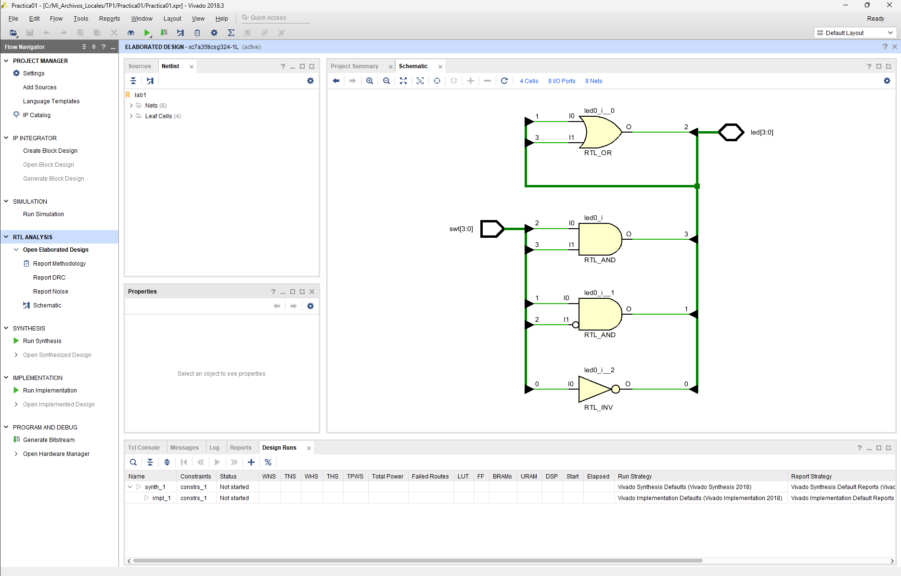
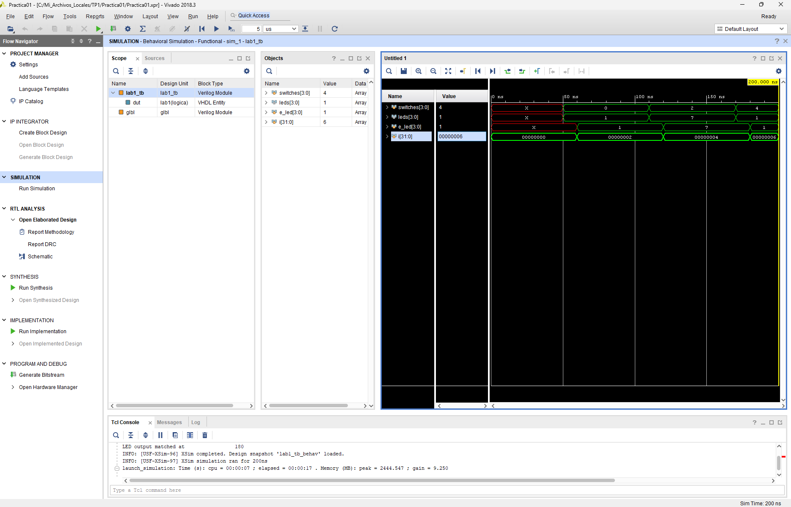
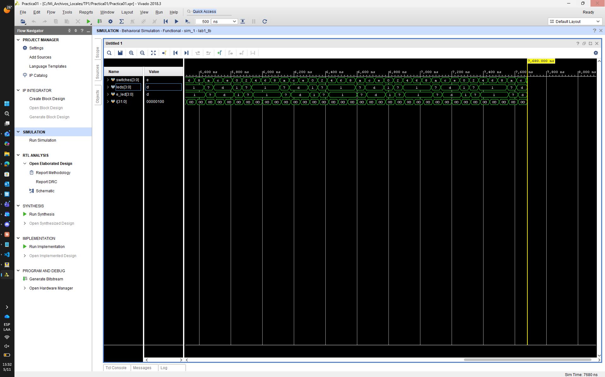
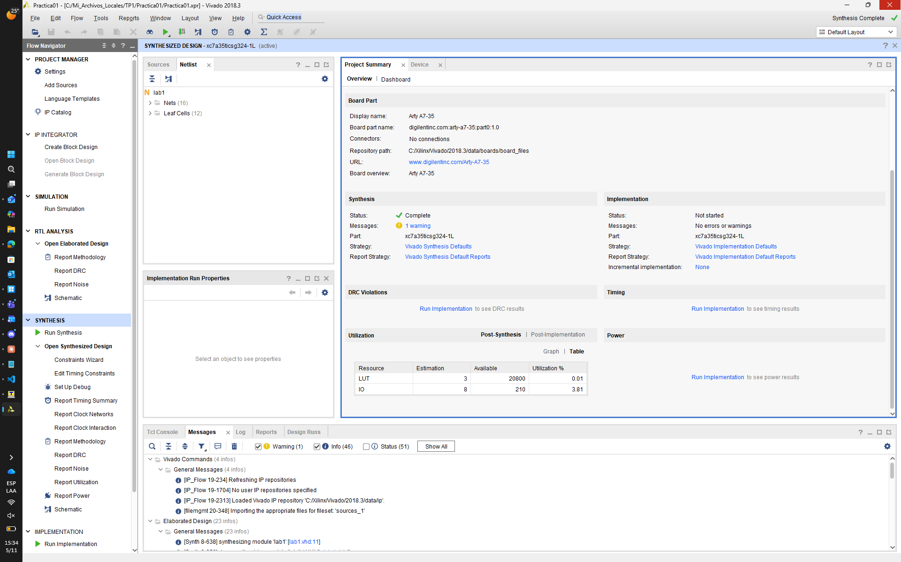
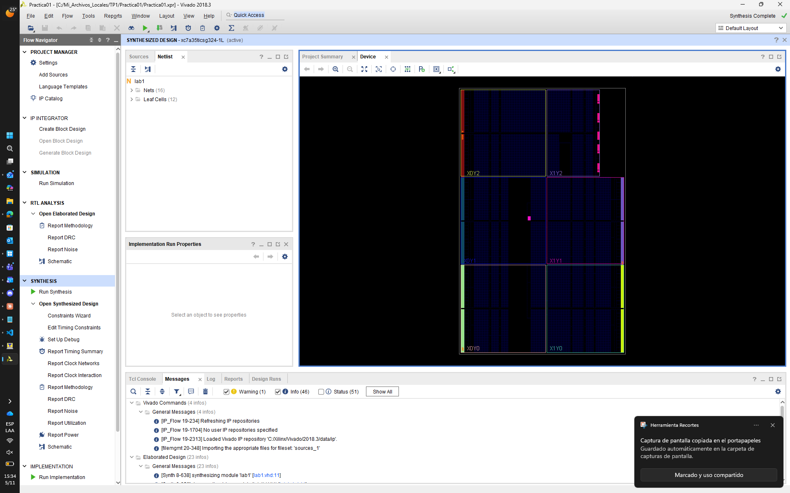
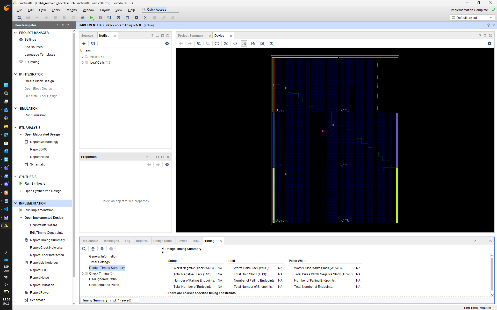
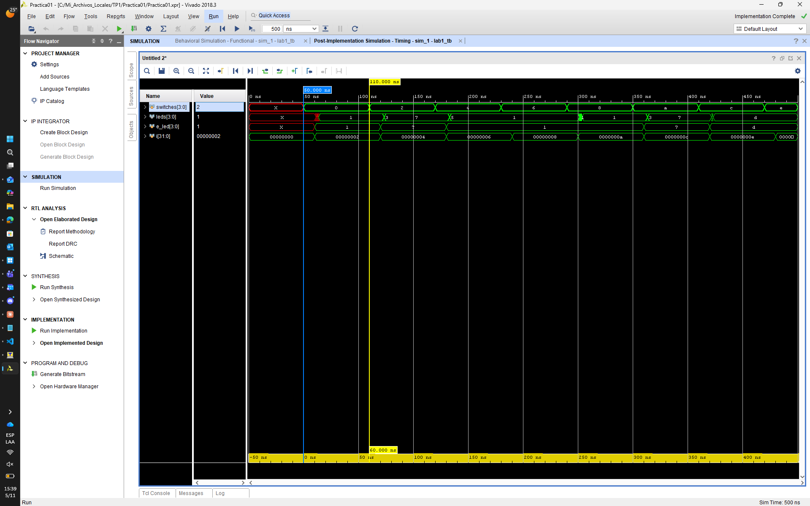

# TP1 — Ciclo de desarrollo con Vivado

**Sistemas Digitales (66.17 / 86.41) · Taller de Sistemas Digitales (TA147) — FIUBA**
**Alumno:** Aleksey Chahuillco · **Padrón:** 110929

| Herramienta | Placa / dispositivo | Proyecto |
|---|---|---|
| Vivado 2018.3 | Digilent **Arty A7-35** — `xc7a35ticsg324-1L` | `TP1\Practica01` (runs `synth_1` / `impl_1`) |

---

## 1. Objetivo

Recorrer el flujo completo de Vivado sobre un sistema combinacional simple: crear el proyecto a partir de un HDL y un XDC, hacer el análisis RTL, la simulación funcional, la síntesis, la implementación y la simulación temporal, generar el bitstream y verificar el funcionamiento en la placa.

### Sistema

Cuatro entradas `swt[3:0]` y cuatro salidas `led[3:0]` con las siguientes funciones lógicas (`lab1.vhd`, provisto por la cátedra, sin modificaciones):

```vhdl
entity lab1 is
	port (swt : in STD_LOGIC_VECTOR (3 downto 0);
		  led : inout STD_LOGIC_VECTOR (3 downto 0)
		  );
end lab1;

architecture logica of lab1 is
begin
   led(0) <= not swt(0);
   led(1) <= swt(1) and not swt(2);
   led(2) <= led(1) or led(3);
   led(3) <= swt(2) and swt(3);
end logica;
```

---

## 2. Adaptación del enunciado (Arty Z7-10) a la Arty A7-35

El enunciado está escrito para la Arty Z7-10 y su archivo `lab1_ArtyZ7_10.xdc`. Para la Arty A7-35 se escribió `lab1_ArtyA7_35.xdc` (Anexo A), con los pines tomados del archivo maestro de Digilent:

| Señal | Z7-10 (enunciado) | **A7-35** | Recurso | Banco |
|---|---|---|---|---|
| `swt[0]` | D19 (BTN0) | **A8** | Switch SW0 | 16 |
| `swt[1]` | D20 (BTN1) | **C11** | Switch SW1 | 16 |
| `swt[2]` | L20 (BTN2) | **C10** | Switch SW2 | 16 |
| `swt[3]` | L19 (BTN3) | **A10** | Switch SW3 | 16 |
| `led[0]` | R14 (LD0) | **H5** | LED LD4 | 35 |
| `led[1]` | P14 (LD1) | **J5** | LED LD5 | 35 |
| `led[2]` | N16 (LD2) | **T9** | LED LD6 | 14 |
| `led[3]` | M14 (LD3) | **T10** | LED LD7 | 14 |

Se usaron los **interruptores deslizantes** en lugar de los botones: la A7 tiene cuatro y quedan fijos en su posición, lo que facilita recorrer la tabla de verdad. La Z7 solo tiene dos, por eso el enunciado usa botones. Además se agregaron `CFGBVS` y `CONFIG_VOLTAGE` para evitar la advertencia DRC del banco de configuración.

> **Antecedente:** antes de tener la placa, el TP se había hecho sobre la Z7 con un top `lab1_vio` y un core **VIO** (*Virtual Input/Output*), que permite estimular las entradas y leer las salidas por JTAG. Ese proyecto (`TP1\lab1`) queda como referencia, pero no se puede portar directamente a la A7, porque el IP queda asociado al dispositivo para el que se generó. Con la placa disponible se siguió el enunciado original, con `lab1` como top.

---

## 3. Paso 1 — Proyecto y análisis RTL

Se creó el proyecto **`Practica01`** (RTL Project, VHDL) para la placa **Arty A7-35** (board part `digilentinc.com:arty-a7-35:part0:1.0`). Se agregaron `lab1.vhd` como fuente de diseño, `lab1_ArtyA7_35.xdc` como restricción y `lab1_tb.v` como fuente de simulación, todos con *Copy sources into project*.


*Figura 1. Análisis RTL (*Open Elaborated Design → Schematic*): 4 celdas genéricas (`RTL_INV`, dos `RTL_AND` —una con entrada negada— y `RTL_OR`), 8 puertos de I/O y 8 redes. Se ve la **realimentación** de `led[1]` y `led[3]` hacia la entrada de la `RTL_OR`, que es la razón por la que `led` se declaró `inout`.*

---

## 4. Paso 2 — Simulación funcional

Se fijó el tiempo de simulación en 200 ns (*Settings → Simulation*) y se ejecutó **Run Behavioral Simulation** con el testbench autoverificable `lab1_tb.v`. El testbench aplica un valor a `switches` cada 60 ns, calcula la salida esperada `e_led` con una función Verilog que replica la lógica y compara contra `leds`, imprimiendo el resultado con `$display`.


*Figura 2. Primeros 200 ns: `switches` = 0, 2, 4 y `leds` = 1, 7, 1, igual a `e_led`. La consola muestra `LED output matched`.*


*Figura 3. Simulación continuada hasta completar el testbench (7680 ns = 128 iteraciones × 60 ns): `leds` coincide con `e_led` en todos los pasos.*

| `switches` (hex) | 0 | 2 | 4 | 6 | 8 | A | C | E |
|---|---|---|---|---|---|---|---|---|
| `leds` (hex) | 1 | 7 | 1 | 1 | 1 | 7 | D | D |
| `e_led` (hex) | 1 | 7 | 1 | 1 | 1 | 7 | D | D |

**Observación sobre el testbench.** El bucle es `for (i=0; i < 255; i=i+2) switches = i;`. Como `i` avanza de a 2, **`swt[0]` vale siempre 0**: solo se prueban las 8 combinaciones pares (0, 2, …, E), que se repiten 16 veces. Por eso, en simulación `led[0]` vale siempre 1 y **nunca se verifica el inversor con `swt[0] = 1`**. Las 8 combinaciones impares sí se verificaron en la placa (sección 8). Para cubrir las 16 en simulación alcanzaría con usar `i = i + 1`.

---

## 5. Paso 3 — Síntesis


*Figura 4. Project Summary: placa Arty A7-35, síntesis completa, utilización estimada de **3 LUT** y **8 IO** (4 entradas + 4 salidas).*


*Figura 5. Vista del dispositivo sintetizado (6 regiones de reloj, X0Y0–X1Y2). Todavía no hay ubicación de lógica.*

La síntesis inserta automáticamente los **IBUF** y **OBUF** en los puertos y mapea las compuertas a **LUTs**. Según el reporte de utilización, las 4 funciones se implementan con **1 LUT1** (el inversor) y **3 LUT2** (dos AND y la OR), pero ocupan solo **3 LUTs físicas**. Esto se debe a que dos funciones pequeñas comparten una misma LUT6 a través de sus dos salidas O5/O6 (*LUT combining*). Coincide con lo que indica el enunciado: "las 4 compuertas se mapean a LUTs" y "la estimación es de tres LUTs".

---

## 6. Paso 4 — Implementación


*Figura 6. Diseño implementado: ruteo desde los pines de los switches (banco 16) hasta las LUTs y desde ellas a los pines de los LEDs (bancos 35 y 14). El Timing Summary indica **"There are no user specified timing constraints"**: el circuito es puramente combinacional y no tiene reloj, así que no hay ningún camino que analizar.*

| Recurso | Usado | Disponible | % |
|---|---|---|---|
| Slice LUTs | 3 | 20 800 | 0,01 |
| Slice Registers | **0** | 41 600 | 0 |
| Slices | 3 | 8 150 | 0,04 |
| Bonded IOB | 8 | 210 | 3,81 |
| BUFGCTRL | 0 | 32 | 0 |

No se usan registros ni buffers de reloj, como corresponde a un circuito combinacional.

**Advertencias de la implementación:**

| Mensaje | Explicación |
|---|---|
| `[DRC RPBF-3] IO port buffering is incomplete` ×4 (`led[0..3]`) | Como `led` está declarado `inout`, Vivado espera un buffer bidireccional (IOBUF: entrada y salida). Pero la lectura de `led(1)` y `led(3)` se resuelve internamente, así que solo se instancia el OBUF. En el reporte de I/O los pines figuran como `BIDIR`. Es inofensivo, pero se evita declarando `led` como `out` y usando señales internas para la realimentación. |
| `[Place 46-29] place_design is not in timing mode` | Sin restricciones de timing, el placer no hace optimización física guiada por timing. Es esperable. |

**Potencia.** El reporte estima 3,23 W totales, de los cuales 3,10 W son "I/O", con *Confidence Level: Low*. Esa cifra **no es realista**: sin relojes ni actividad de simulación, el estimador vectorless no tiene una frecuencia de referencia para las señales de I/O y asume una tasa de conmutación arbitraria. La potencia estática (67 mW) sí es comparable con la de los otros TPs (62–66 mW). Para una estimación válida haría falta un archivo de actividad (SAIF) o definir la tasa de conmutación de las entradas.

---

## 7. Paso 5 — Simulación temporal

Se ejecutó **Run Post-Implementation Timing Simulation**: la misma simulación, pero sobre la netlist ruteada con los retardos reales (SDF) de IBUF, LUTs, red y OBUF.


*Figura 7. Simulación post-implementación con marcadores en 50 ns y 110 ns (Δ = 60 ns, el paso del testbench).*

Diferencias respecto de la simulación funcional:

1. **Retardo de propagación.** `switches` cambia en 50 ns y `leds` recién toma su valor final varios nanosegundos después. Entre 50 ns y ≈ 58 ns se ve en rojo, como valor indefinido (`X`), mientras las señales atraviesan IBUF → LUT → OBUF. En la simulación funcional el cambio era instantáneo. El enunciado indica que `leds` cambia a ≈ 58 ns y `e_led` a ≈ 59,7 ns.
2. **Glitches (riesgos estáticos).** En algunas transiciones `leds` pasa por **valores intermedios** antes de estabilizarse:
   - `1 → 3 → 7` al pasar de `switches` = 0 a 2 (≈ 110 ns);
   - `7 → 5 → 1` al pasar de 2 a 4 (≈ 160 ns);
   - un pulso angosto al pasar de 6 a 8 (≈ 300 ns).

   Ocurren porque cada salida tiene un camino de distinta longitud (ruteo hacia bancos distintos) y porque `led[2]` depende de `led[1]` y `led[3]`, que llegan con retardos diferentes. Son pulsos de pocos nanosegundos, invisibles en un LED, pero muestran por qué **en un sistema sincrónico las salidas combinacionales se registran** antes de usarse.
3. `e_led` cambia 10 ns después del estímulo porque el testbench lo calcula con `#10`. No es un retardo del circuito.

---

## 8. Paso 6 — Bitstream y verificación en hardware

Se generó `Practica01.runs\impl_1\lab1.bit` y se programó la placa desde el *Hardware Manager*: *Open Target → Auto Connect → `xc7a35t_0` → Program Device*. El LED **DONE** se encendió al finalizar la configuración.

Se recorrieron las 16 combinaciones de los interruptores y **todos los LEDs respondieron según la tabla de verdad**. LEDs: LD7 LD6 LD5 LD4 = `led[3] led[2] led[1] led[0]`, ● encendido, ○ apagado.

| SW3 SW2 SW1 SW0 | LD7 LD6 LD5 LD4 | | SW3 SW2 SW1 SW0 | LD7 LD6 LD5 LD4 |
|---|---|---|---|---|
| 0 0 0 0 | ○ ○ ○ ● ✔ | | 1 0 0 0 | ○ ○ ○ ● ✔ |
| 0 0 0 1 | ○ ○ ○ ○ ✔ | | 1 0 0 1 | ○ ○ ○ ○ ✔ |
| 0 0 1 0 | ○ ● ● ● ✔ | | 1 0 1 0 | ○ ● ● ● ✔ |
| 0 0 1 1 | ○ ● ● ○ ✔ | | 1 0 1 1 | ○ ● ● ○ ✔ |
| 0 1 0 0 | ○ ○ ○ ● ✔ | | 1 1 0 0 | ● ● ○ ● ✔ |
| 0 1 0 1 | ○ ○ ○ ○ ✔ | | 1 1 0 1 | ● ● ○ ○ ✔ |
| 0 1 1 0 | ○ ○ ○ ● ✔ | | 1 1 1 0 | ● ● ○ ● ✔ |
| 0 1 1 1 | ○ ○ ○ ○ ✔ | | 1 1 1 1 | ● ● ○ ○ ✔ |

La tabla coincide con las ecuaciones:
- LD4 = ¬SW0
- LD5 = SW1·¬SW2
- LD7 = SW2·SW3
- LD6 = LD5 + LD7

A diferencia de la simulación, en la placa se verificaron también las **8 combinaciones con SW0 = 1**.

---

## 9. Conclusiones

1. Se completó el flujo de Vivado de punta a punta (proyecto → RTL → simulación funcional → síntesis → implementación → simulación temporal → bitstream → hardware), portando el TP de la Arty Z7-10 a la Arty A7-35. Para eso alcanzó con reescribir el archivo de restricciones, sin tocar el HDL.
2. El XDC es el único vínculo entre el diseño y la placa: los mismos puertos `swt`/`led` se conectan a pines distintos (y a recursos distintos, switches en vez de botones) solo cambiando `PACKAGE_PIN`.
3. La síntesis mapea las 4 compuertas a 4 funciones de LUT empaquetadas en 3 LUTs físicas, más 4 IBUF y 4 OBUF, sin registros ni relojes.
4. Sin reloj no hay restricciones de timing ni análisis estático. La **simulación temporal** es entonces la herramienta para observar los retardos reales y los **glitches** que produce la diferencia entre caminos.
5. El testbench provisto solo cubre las combinaciones pares de las entradas. La verificación en la placa completó la cobertura.
6. Declarar `led` como `inout` para leer las salidas funciona, pero genera advertencias de buffering (RPBF-3). En VHDL es preferible usar señales internas.

---

## Anexo A — `lab1_ArtyA7_35.xdc`

```tcl
set_property -dict { PACKAGE_PIN A8     IOSTANDARD LVCMOS33 } [get_ports { swt[0] }]; #IO_L12N_T1_MRCC_16 Sch=sw[0]
set_property -dict { PACKAGE_PIN C11    IOSTANDARD LVCMOS33 } [get_ports { swt[1] }]; #IO_L13P_T2_MRCC_16 Sch=sw[1]
set_property -dict { PACKAGE_PIN C10    IOSTANDARD LVCMOS33 } [get_ports { swt[2] }]; #IO_L13N_T2_MRCC_16 Sch=sw[2]
set_property -dict { PACKAGE_PIN A10    IOSTANDARD LVCMOS33 } [get_ports { swt[3] }]; #IO_L14P_T2_SRCC_16 Sch=sw[3]

set_property -dict { PACKAGE_PIN H5     IOSTANDARD LVCMOS33 } [get_ports { led[0] }]; #IO_L24N_T3_35 Sch=led[4]
set_property -dict { PACKAGE_PIN J5     IOSTANDARD LVCMOS33 } [get_ports { led[1] }]; #IO_25_35 Sch=led[5]
set_property -dict { PACKAGE_PIN T9     IOSTANDARD LVCMOS33 } [get_ports { led[2] }]; #IO_L24P_T3_A01_D17_14 Sch=led[6]
set_property -dict { PACKAGE_PIN T10    IOSTANDARD LVCMOS33 } [get_ports { led[3] }]; #IO_L24N_T3_A00_D16_14 Sch=led[7]

set_property CFGBVS VCCO [current_design]
set_property CONFIG_VOLTAGE 3.3 [current_design]
```

