# TP2 — Procesos de Elaboración y Síntesis

**Sistemas Digitales (66.17 / 86.41) · Taller de Sistemas Digitales (TA147) — FIUBA**
**Alumno:** Aleksey Chahuillco · **Padrón:** 110929

| Herramienta | Placa / dispositivo | Proyecto |
|---|---|---|
| Vivado 2018.3 | Digilent **Arty A7-35** — `xc7a35ticsg324-1L` | `TP2\Practica02` (runs `synth_1` / `synth_flatten`) |

---

## 1. Objetivo

Realizar la elaboración y la síntesis de un sistema digital de mediana complejidad, una **UART receptora** (`uart_led`), y analizar los resultados: esquemáticos, utilización de recursos, estimación de temporización y efecto de la estrategia de síntesis. Por último, guardar y reabrir el diseño sintetizado mediante *checkpoints*.

El sistema recibe caracteres por UART (115200 8N1) y muestra un nibble del código ASCII en 4 LEDs; un botón selecciona qué nibble se muestra.

| Módulo | Función |
|---|---|
| `uart_top` | Top-level: instancia `uart_led` con los generics `BAUD_RATE` y `CLOCK_RATE` |
| `uart_led` | Une el receptor, los sincronizadores y el control de LEDs |
| `meta_harden` | Sincronizador de dos etapas para las entradas asincrónicas (`rst_pin`, `btn_pin`, `rxd_pin`) |
| `uart_rx` | Receptor: generador de baudios + controlador |
| `uart_baud_gen` | Genera el pulso de sobremuestreo ×16 |
| `uart_rx_ctl` | FSM que detecta el bit de start, muestrea los 8 bits y valida el stop |
| `led_ctl` | Registra el carácter recibido y selecciona el nibble que va a los LEDs |

---

## 2. Adaptación del enunciado (Arty Z7-10) a la Arty A7-35

| Ítem | Enunciado (Z7-10) | Implementado (A7-35) | Motivo |
|---|---|---|---|
| Reloj del sistema | 125 MHz | **100 MHz** (pin E3) | Oscilador de la A7 |
| `CLOCK_RATE` en `uart_top.vhd` | 125E6 | **100E6** | Coincide con el reloj de la placa |
| `create_clock clk_pin` | 8 ns | **10 ns**, `-waveform {0 5}` | |
| Reloj virtual | 12 ns | 12 ns (igual) | |
| Input delay `rst_pin`, `btn_pin` | máx. 0 / mín. −0,5 ns | igual | |
| Output delay `led_pins` | máx. 0 / mín. −0,5 ns | igual | |

Con 100 MHz, el divisor del generador de baudios queda en (100·10⁶ + 921 600) / (115 200 · 16) = **54**, lo que da 100·10⁶ / (54 · 16) ≈ **115 741 bps**, un error de 0,47 %, muy por debajo de la tolerancia del receptor.

### Pines (`uart_led_pins_ArtyA7.xdc`)

| Puerto | Pin | Recurso de la placa | Banco |
|---|---|---|---|
| `clk_pin` | E3 | Oscilador 100 MHz | 35 |
| `rst_pin` | D9 | BTN0 | 16 |
| `btn_pin` | C9 | BTN1 | 16 |
| `rxd_pin` | A9 | `uart_txd_in` (USB-UART, PC → FPGA) | 16 |
| `led_pins[0..1]` | H5, J5 | LD4, LD5 | 35 |
| `led_pins[2..3]` | T9, T10 | LD6, LD7 | 14 |

Se agregaron además `CFGBVS VCCO` y `CONFIG_VOLTAGE 3.3` para el banco de configuración.

---

## 3. Paso 1 — Creación del proyecto

Se creó el proyecto **`Practica02`** (RTL Project, VHDL) sobre la parte `xc7a35ticsg324-1L`, con los siete archivos `.vhd` de la UART como fuentes de diseño y los dos `.xdc` (pines y temporización) como restricciones, todos con *Copy sources into project*. `uart_top` quedó como top-level.

---

## 4. Paso 2 — Elaboración

Se abrió el diseño elaborado (*RTL Analysis → Open Elaborated Design*). En esta etapa Vivado interpreta el HDL y lo representa con celdas genéricas (registros, multiplexores, comparadores, sumadores), sin mapearlo todavía a los recursos del dispositivo.

**Análisis de ruido de conmutación simultánea (SSN).** Con el XDC de pines cargado, el reporte *Report Noise* no muestra errores ni advertencias adicionales. Las cuatro salidas de los LEDs quedan repartidas en dos bancos:

| Banco | Pines | Puertos |
|---|---|---|
| 14 | T9, T10 | `led_pins[2]`, `led_pins[3]` |
| 35 | H5, J5 | `led_pins[0]`, `led_pins[1]` |

Las entradas (`rst_pin`, `btn_pin`, `rxd_pin`) no intervienen en el análisis SSN, que solo evalúa las salidas que conmutan en simultáneo.

**Advertencia de elaboración.** Se reporta una lista de sensibilidad incompleta en `led_ctl.vhd`: la asignación `led_o <= led_pipeline_reg;` está dentro del `process(clk_rx)` pero fuera del `if rising_edge(clk_rx)`. En hardware se sintetiza como una conexión directa del registro a la salida.

---

## 5. Paso 3 — Síntesis

### 5.1 Síntesis con la estrategia por defecto del proyecto (`synth_1`)

La corrida `synth_1` se ejecutó con la estrategia **Flow_RuntimeOptimized** (jerarquía conservada).

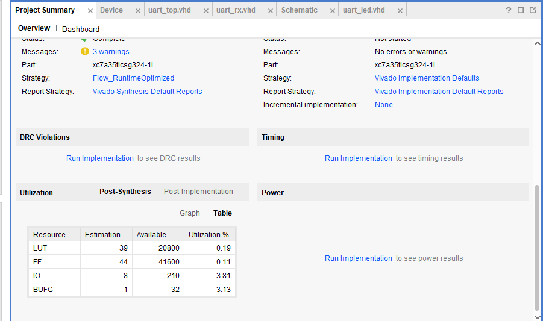
*Figura 1. Tabla 1 — Utilización estimada post-síntesis.*

**Tabla 1 — Utilización**

| Recurso | Estimación | Disponible | Utilización % |
|---|---|---|---|
| LUT | 39 | 20 800 | 0,19 |
| FF | 44 | 41 600 | 0,11 |
| IO | 8 | 210 | 3,81 |
| BUFG | 1 | 32 | 3,13 |

Por jerarquía, `U0` (`uart_led`) usa 39 LUT, 44 FF, 0 IO y 0 BUFG: los IBUF, OBUF y el BUFG del reloj se insertan en el top-level `uart_top`. Los 8 IO son 4 entradas (`clk_pin`, `rst_pin`, `btn_pin`, `rxd_pin`) y 4 salidas (`led_pins`).

### 5.2 Estimación de temporización

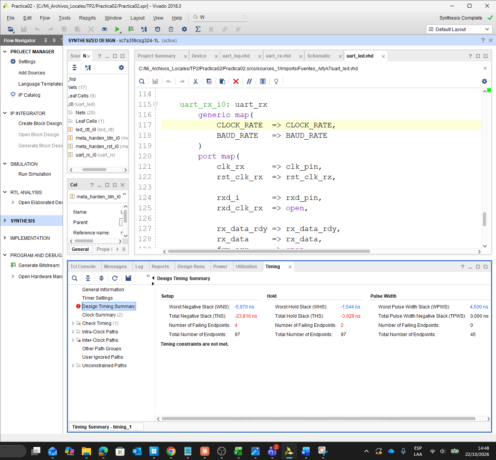
*Figura 2. Design Timing Summary post-síntesis y jerarquía del diseño (`U0` con `led_ctl_i0`, `meta_harden_btn_i0`, `meta_harden_rst_i0` y `uart_rx_i0`).*

| | WNS / WHS | TNS / THS | Endpoints que fallan | Endpoints totales |
|---|---|---|---|---|
| Setup | **−5,970 ns** | −23,816 ns | 4 (`led_pins[0..3]`) | 97 |
| Hold | **−1,544 ns** | −3,029 ns | 2 (`rst_pin`, `btn_pin`) | 97 |
| Pulse width | +4,500 ns | 0 | 0 | 45 |

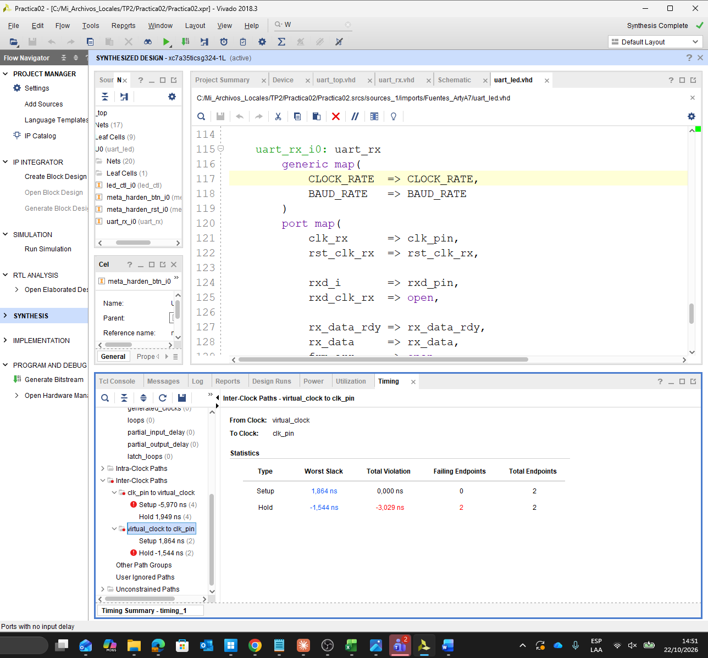
*Figura 3. Caminos entre relojes: `virtual_clock → clk_pin` (entradas) cumple setup con +1,864 ns pero falla hold con −1,544 ns; `clk_pin → virtual_clock` (salidas a los LEDs) falla setup.*

**Setup de las salidas.** `clk_pin` tiene período de 10 ns y `virtual_clock` de 12 ns. Vivado analiza todos los pares de flancos dentro del mínimo común múltiplo (60 ns) y toma el más exigente: **lanzamiento en 10 ns y captura en 12 ns**, es decir, un requisito de **2 ns**. El camino desde el registro de `led_ctl` hasta el pad del LED es:

| Tramo | Tiempo |
|---|---|
| Flanco de lanzamiento | 10,000 ns |
| *Source Clock Path* (IBUF + BUFG + red hasta el FF) | 2,968 ns |
| *Data Path* (clk→Q + red + OBUF) | 4,977 ns |
| **Arrival time** | **17,945 ns** |
| Required = 12 − 0,025 (incertidumbre) − 0 (output delay) | **11,975 ns** |
| **Slack** | **−5,970 ns** |

El problema no es la lógica (el registro va directo al OBUF) sino la relación entre los dos relojes y el retardo propio del buffer de salida.

**Hold de las entradas.** El chequeo de hold se hace contra el mismo flanco. El dato de `rst_pin` / `btn_pin` llega muy temprano (input delay mínimo −0,5 ns + IBUF), mientras que el reloj de captura llega con ≈ 2 ns de retardo de inserción (IBUF + BUFG + árbol de reloj). El flip-flop todavía está capturando el valor anterior cuando cambia el dato, y el slack resulta −1,544 ns. En esta etapa los retardos de red son estimados; el ruteo real se analiza en el TP3.

**Check Timing.** Informa que `rxd_pin` no tiene input delay, ya que el XDC de temporización no lo restringe. La entrada serie es asincrónica y se sincroniza con `meta_harden`.

### 5.3 Síntesis con otra estrategia (`synth_flatten`)

Se creó una segunda corrida, **`synth_flatten`**, con la estrategia **Flow_PerfOptimized_high** y `flatten_hierarchy = full`.

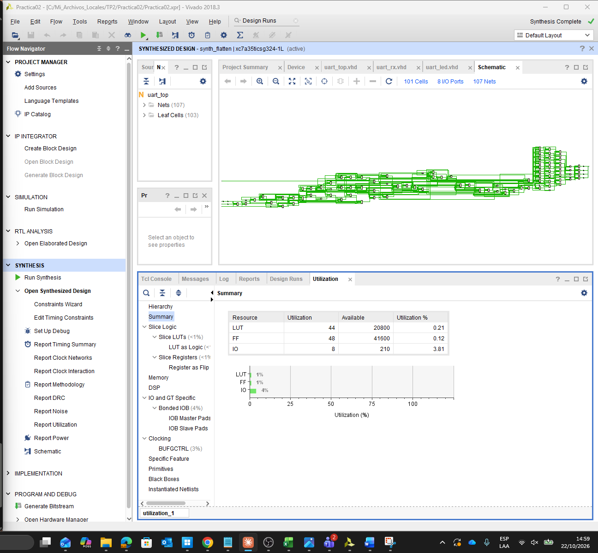
*Figura 4. Diseño sintetizado con `synth_flatten`: un único nivel de jerarquía (`uart_top` con 103 celdas hoja y 107 redes) y utilización de 44 LUT, 48 FF y 8 IO.*

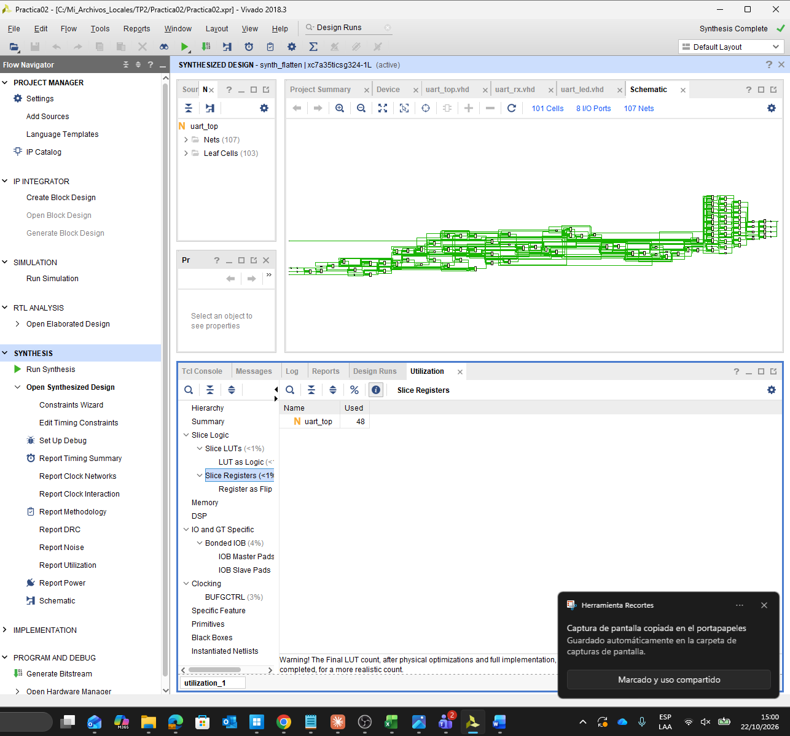
*Figura 5. Slice Registers: 48, todos dentro de `uart_top`, sin submódulos.*

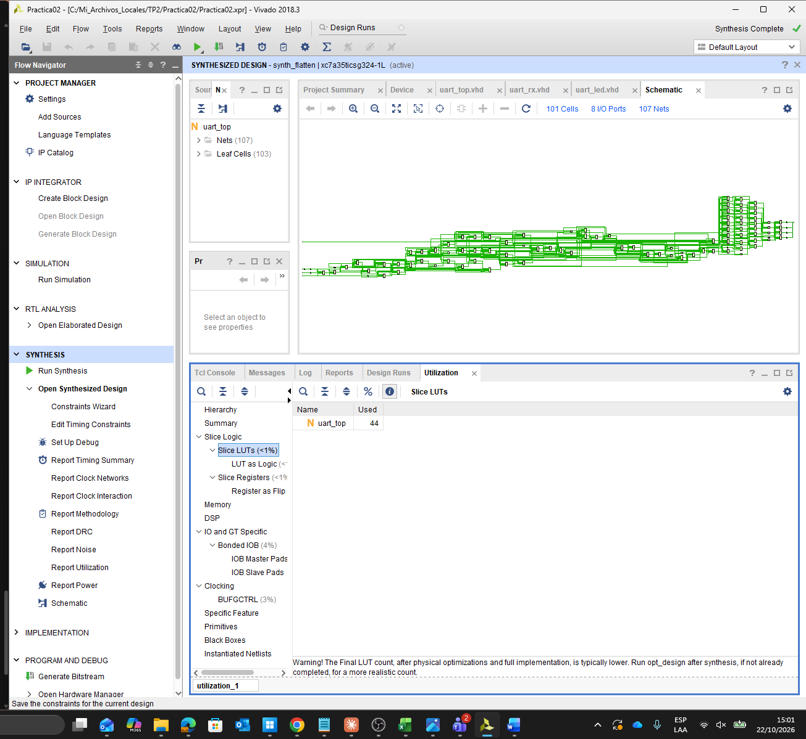
*Figura 6. Slice LUTs: 44.*

| | `synth_1` | `synth_flatten` |
|---|---|---|
| Estrategia | Flow_RuntimeOptimized | Flow_PerfOptimized_high |
| `flatten_hierarchy` | jerarquía conservada | full |
| LUT | 39 | **44** |
| FF | 44 | **48** |
| IO / BUFG | 8 / 1 | 8 / 1 |
| Endpoints de timing | 97 | **111** |
| WNS / WHS | −5,970 / −1,544 | −5,970 / −1,544 |
| Jerarquía | `U0` y submódulos | un solo nivel |

El aumento de recursos se explica por las opciones de la estrategia orientada a rendimiento:

- **`fsm_extraction = one_hot`**: la FSM de `uart_rx_ctl` pasa de codificación binaria (2 FF) a *one-hot* (4 FF, uno por estado).
- **`keep_equivalent_registers`**: no se fusionan registros equivalentes.
- **`no_lc`**: se deshabilita el *LUT combining*, por lo que dos funciones pequeñas ya no comparten una misma LUT6.
- **`resource_sharing = off`**: no se comparten operadores aritméticos.

La estrategia gasta área para facilitar la velocidad, pero el timing no cambia: los caminos que fallan son de I/O (registro → OBUF y pad → registro), que no dependen de la lógica que la estrategia optimiza.

---

## 6. Paso 4 — Checkpoints

Se guardaron los diseños sintetizados como *checkpoints* (*File → Checkpoint → Write*): `checkpoint_1.dcp` a partir de `synth_1` y `checkpoint_2.dcp` a partir de `synth_flatten`. Luego se abrieron en forma independiente del proyecto (*File → Checkpoint → Open*).

### 6.1 `checkpoint_1.dcp`

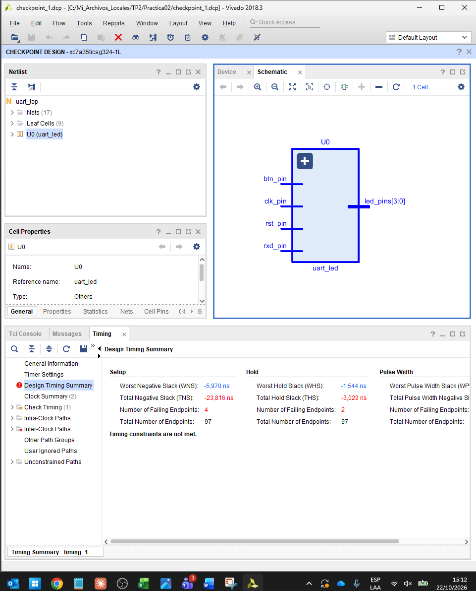
*Figura 7. `checkpoint_1.dcp` abierto como *Checkpoint Design*: la instancia `U0 (uart_led)` se conserva como bloque jerárquico y el Timing Summary es idéntico al de `synth_1` (WNS −5,970, WHS −1,544, 97 endpoints).*

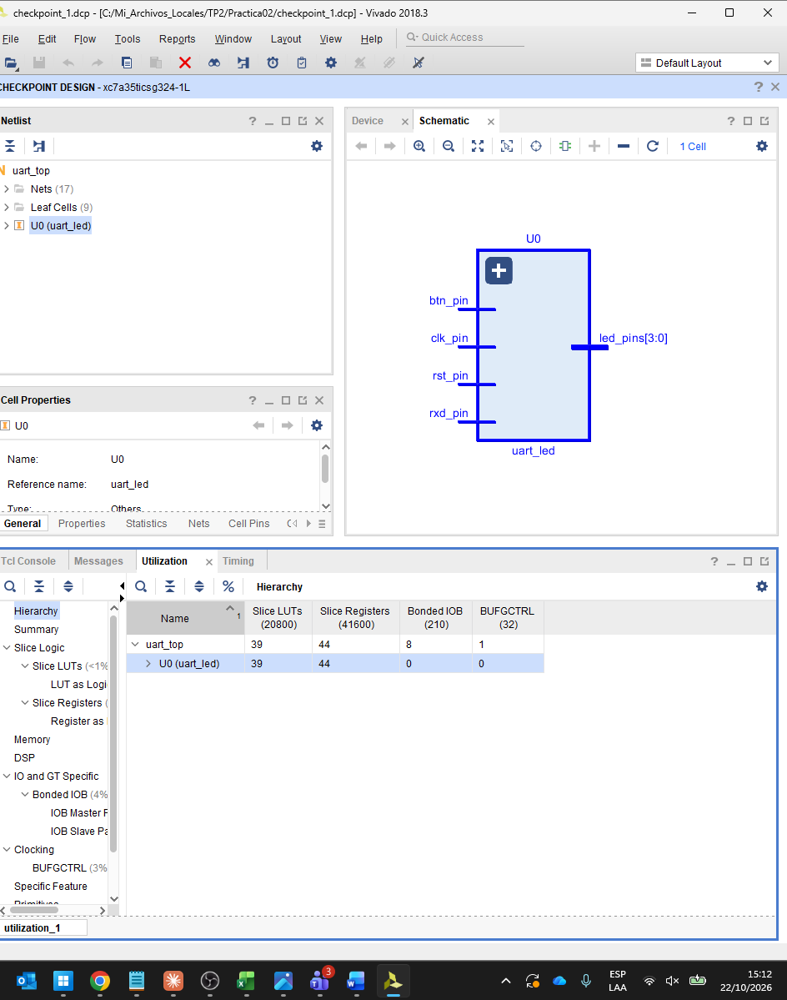
*Figura 8. Utilización por jerarquía: `U0` con 39 LUT y 44 FF.*

### 6.2 `checkpoint_2.dcp`

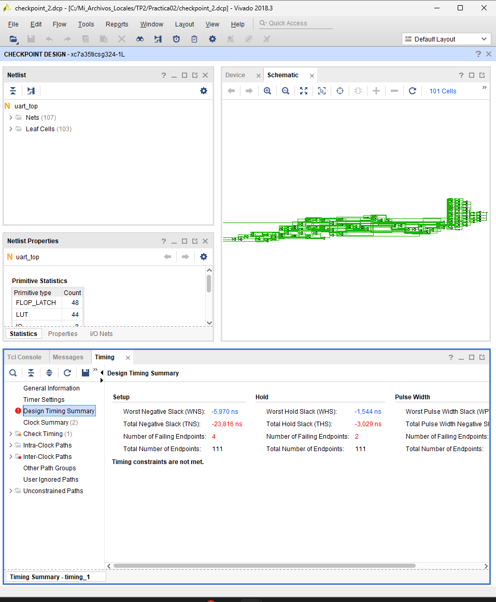
*Figura 9. Timing de `checkpoint_2.dcp`: los mismos valores que `synth_flatten`, con 111 endpoints.*

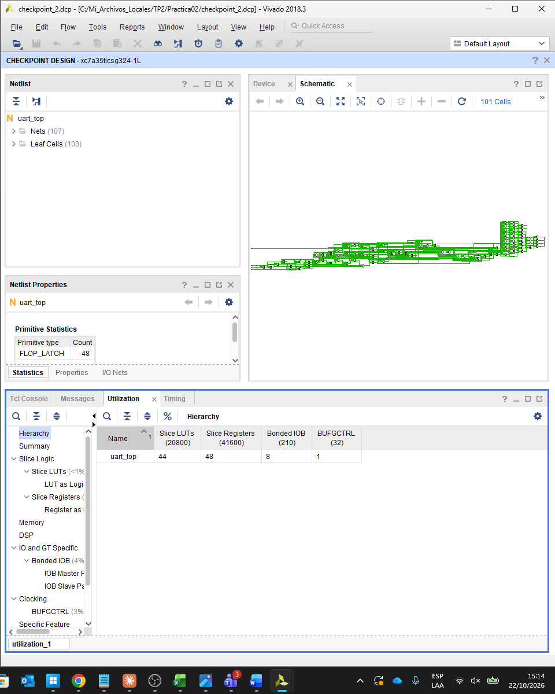
*Figura 10. Utilización: `uart_top` con 44 LUT, 48 FF, 8 IO y 1 BUFG, sin submódulos.*

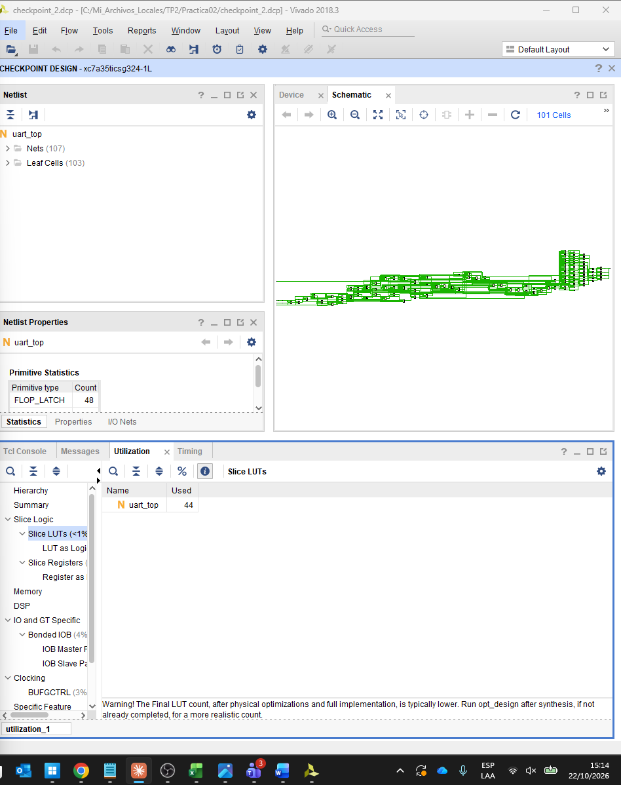
*Figura 11. Slice LUTs del checkpoint 2.*

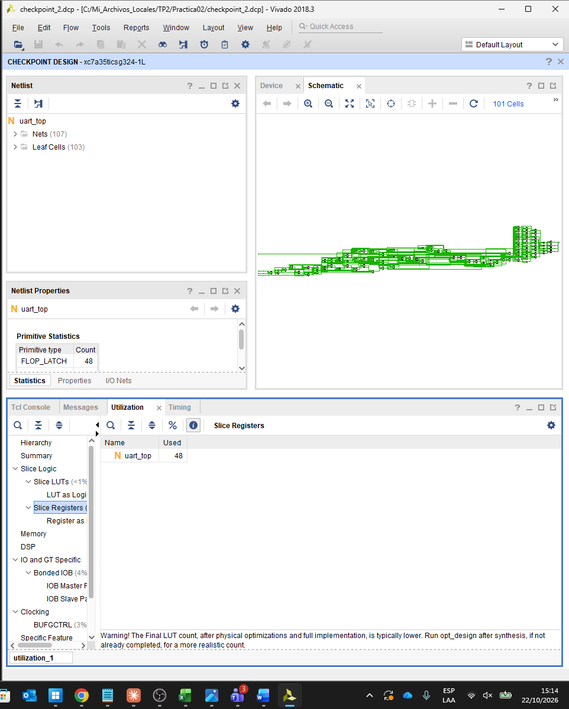
*Figura 12. Slice Registers del checkpoint 2.*

Un checkpoint guarda la netlist, las restricciones y, si existe, la información de ubicación y ruteo. Al abrirlo se reproducen exactamente los reportes de utilización y de temporización sin volver a sintetizar, lo que permite archivar el estado del diseño en cada etapa o compartirlo sin el proyecto completo.

---

## 7. Conclusiones

1. La **elaboración** traduce el HDL a una representación genérica e independiente de la tecnología, y permite detectar problemas de codificación (como la lista de sensibilidad incompleta de `led_ctl`) y de asignación de pines (SSN) antes de sintetizar.
2. La **síntesis** mapea el diseño a los recursos del Artix-7: 39 LUT y 44 FF en la estrategia por defecto, e inserta automáticamente los buffers de I/O y el BUFG del reloj en el top-level.
3. El diseño **no cumple timing** con las restricciones dadas, pero las violaciones son de I/O: en setup, por la relación de 10 ns contra 12 ns entre el reloj del sistema y el reloj virtual (requisito de 2 ns), y en hold, por el retardo de inserción del reloj frente a entradas con input delay mínimo negativo.
4. La estrategia **Flow_PerfOptimized_high** con jerarquía aplanada aumentó el área (44 LUT / 48 FF) sin mejorar el timing, porque los caminos críticos no son de lógica.
5. Los **checkpoints** conservan el diseño sintetizado de forma autocontenida y reproducen exactamente los resultados de cada corrida.

---

## Anexo A — Restricciones

**`uart_led_pins_ArtyA7.xdc`**

```tcl
set_property -dict { PACKAGE_PIN E3  IOSTANDARD LVCMOS33 } [get_ports clk_pin]
set_property -dict { PACKAGE_PIN D9  IOSTANDARD LVCMOS33 } [get_ports rst_pin]
set_property -dict { PACKAGE_PIN C9  IOSTANDARD LVCMOS33 } [get_ports btn_pin]
set_property -dict { PACKAGE_PIN A9  IOSTANDARD LVCMOS33 } [get_ports rxd_pin]
set_property -dict { PACKAGE_PIN H5  IOSTANDARD LVCMOS33 } [get_ports {led_pins[0]}]
set_property -dict { PACKAGE_PIN J5  IOSTANDARD LVCMOS33 } [get_ports {led_pins[1]}]
set_property -dict { PACKAGE_PIN T9  IOSTANDARD LVCMOS33 } [get_ports {led_pins[2]}]
set_property -dict { PACKAGE_PIN T10 IOSTANDARD LVCMOS33 } [get_ports {led_pins[3]}]

set_property CFGBVS VCCO [current_design]
set_property CONFIG_VOLTAGE 3.3 [current_design]
```

**`uart_led_timing_ArtyA7.xdc`**

```tcl
create_clock -period 10.000 -name clk_pin -waveform {0.000 5.000} [get_ports clk_pin]

create_clock -period 12.000 -name virtual_clock

set_input_delay -clock virtual_clock -max 0.000 [get_ports rst_pin]
set_input_delay -clock virtual_clock -min -0.500 [get_ports rst_pin]

set_input_delay -clock virtual_clock -max 0.000 [get_ports btn_pin]
set_input_delay -clock virtual_clock -min -0.500 [get_ports btn_pin]

set_output_delay -clock virtual_clock -max 0.000 [get_ports {led_pins[*]}]
set_output_delay -clock virtual_clock -min -0.500 [get_ports {led_pins[*]}]
```
