# TP3 — Implementación de un Sistema

**Sistemas Digitales (66.17 / 86.41) · Taller de Sistemas Digitales (TA147) — FIUBA**
**Alumno:** Aleksey Chahuillco · **Padrón:** 110929

| Herramienta | Placa / dispositivo | Proyecto |
|---|---|---|
| Vivado 2018.3 | Digilent **Arty A7-35** — `xc7a35ticsg324-1L` | `TP3\project_3` (runs `synth_2` / `impl_3`) |

---

## 1. Objetivo

Continuar la práctica 2: implementar (place & route) la UART receptora `uart_led`, agregarle un eco por `txd_pin`, analizar la temporización en síntesis y en implementación, ajustar las restricciones hasta cumplir timing y generar el bitstream para verificar el sistema en hardware.

El sistema recibe caracteres por UART (115200 8N1), muestra un nibble del código ASCII en 4 LEDs (bajo con el botón suelto, alto con el botón apretado) y devuelve cada carácter por `txd_pin` (eco).

---

## 2. Adaptación del enunciado (Arty Z7-10) a la Arty A7-35

El enunciado está escrito para la Arty Z7-10 (Zynq, reloj de 125 MHz). La práctica se hizo sobre una **Arty A7-35** (Artix-7, reloj de 100 MHz), con estos cambios:

| Paso | Enunciado (Z7-10) | Implementado (A7-35) | Motivo |
|---|---|---|---|
| 1-2-1 | `clk_pin` de 8 ns (125 MHz) | **10 ns** (sin cambio) | El oscilador de la A7 es de 100 MHz (pin E3) |
| 1-2-2 | `txd_pin` en Y19 (Pmod JA) | **D10** (`uart_rxd_out`) | Se usa el puente USB-UART de la placa; `rxd_pin` ya estaba en A9 (`uart_txd_in`) |
| 1-2-4 | `CLOCK_RATE = 125E6` | **100E6** | Coincide con el generic que pasa `uart_top` |
| 1-3-2 | Reloj virtual 12 → 8 ns | **12 → 10 ns** | La idea del paso es que el reloj virtual sea igual al del sistema; con 8 ns en la A7 el peor par de flancos (30 → 32 ns) volvería a dar 2 ns |
| 4-1 | micro-USB + adaptador USB-serie en JA | **solo micro-USB (J10)** | El FT2232 de la A7 expone JTAG y un puerto COM por el mismo cable |
| 4-2-5 | BTN0 → nibble alto | **BTN1** → nibble alto (BTN0 = reset) | Asignación de pines del TP2 |

El divisor del generador de baudios queda en (100·10⁶ + 921 600) / (115 200 · 16) = **54**, lo que da 100·10⁶ / (54 · 16) ≈ **115 741 bps** (error de 0,47 %, muy por debajo del 5 % que tolera el receptor).

### Pines utilizados (`uart_led_pins_ArtyA7.xdc`)

| Puerto | Pin | Recurso de la placa | Banco |
|---|---|---|---|
| `clk_pin` | E3 | Oscilador 100 MHz | 35 |
| `rst_pin` | D9 | BTN0 | 16 |
| `btn_pin` | C9 | BTN1 | 16 |
| `rxd_pin` | A9 | `uart_txd_in` (PC → FPGA) | 16 |
| `txd_pin` | D10 | `uart_rxd_out` (FPGA → PC) | 16 |
| `led_pins[0..1]` | H5, J5 | LD4, LD5 | 35 |
| `led_pins[2..3]` | T9, T10 | LD6, LD7 | 14 |

---

## 3. Paso 1 — Abrir el proyecto, modificar el diseño y sintetizar

### 3.1 Proyecto y estrategia de síntesis (1-1)

Se abrió el proyecto de la práctica 2 y se guardó como proyecto nuevo en `TP3\project_3` (*File → Project → Save As*). Como las fuentes se habían importado con *Copy sources into project*, el proyecto nuevo tiene su propia copia de los `.vhd` y `.xdc`.

En *Settings → Synthesis* se cambió `flatten_hierarchy` a **rebuilt** y se creó la corrida **`synth_2`**. La estrategia heredada de la práctica 2 es **Flow_PerfOptimized_high**: `rebuilt` aplana para optimizar pero reconstruye la jerarquía, así que se conservan la optimización entre módulos y el análisis por módulo. Esta estrategia codifica la FSM de `uart_rx_ctl` en one-hot, y por eso el diseño tiene **48 FF** y **111 endpoints** de timing.

### 3.2 Modificaciones (1-2-1 a 1-2-5)

**Eco en `uart_top.vhd`:** se agrega el puerto `txd_pin` y se conecta a `rxd_pin` con dos negadores en serie.

```vhdl
entity uart_top is
	port(
		clk_pin:  in  std_logic;
		rst_pin:  in  std_logic;
		btn_pin:  in  std_logic;
		rxd_pin:  in  std_logic;
		txd_pin:  out std_logic;
		led_pins: out std_logic_vector(3 downto 0)
	);
end;
...
	signal loopback: std_logic;
begin
	loopback <= not rxd_pin;
	txd_pin  <= not loopback;
```

**Nibbles en `led_ctl.vhd` (líneas 62 y 64):** se intercambian para que el botón apretado muestre el nibble alto.

```vhdl
if btn_clk_rx = '1' then
	led_pipeline_reg <= char_data(7 downto 4);
else
	led_pipeline_reg <= char_data(3 downto 0);
end if;
```

**Pin de transmisión (`uart_led_pins_ArtyA7.xdc`):**

```tcl
set_property -dict {PACKAGE_PIN D10 IOSTANDARD LVCMOS33} [get_ports txd_pin]
```

### 3.3 Síntesis con reloj virtual de 12 ns (1-2-6 a 1-2-16)

En el diseño elaborado, `rxd_pin` llega a `txd_pin` a través de dos negadores. En el diseño sintetizado **los negadores desaparecen**: la herramienta reconoce que `not(not x) = x` y conecta `rxd_pin → IBUF → OBUF → txd_pin`. El IBUF de `rxd_pin` alimenta también a `U0`. El diseño usa **9 I/O**.

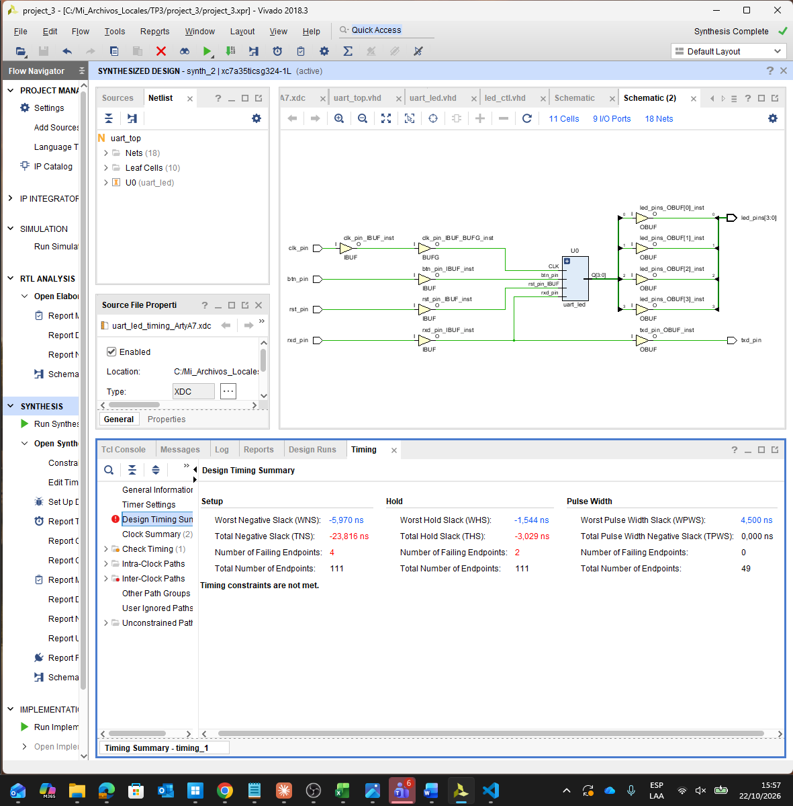
*Figura 1. Esquemático sintetizado (IBUF/BUFG en las entradas, OBUF en las salidas, eco rxd → txd sin lógica) y Timing Summary con reloj virtual de 12 ns.*

| | WNS / WHS | TNS / THS | Endpoints que fallan |
|---|---|---|---|
| Setup | **−5,970 ns** | −23,816 ns | 4 (`led_pins[0..3]`, clk_pin → virtual_clock) |
| Hold | **−1,544 ns** | −3,029 ns | 2 (`rst_pin`, `btn_pin`, virtual_clock → clk_pin) |

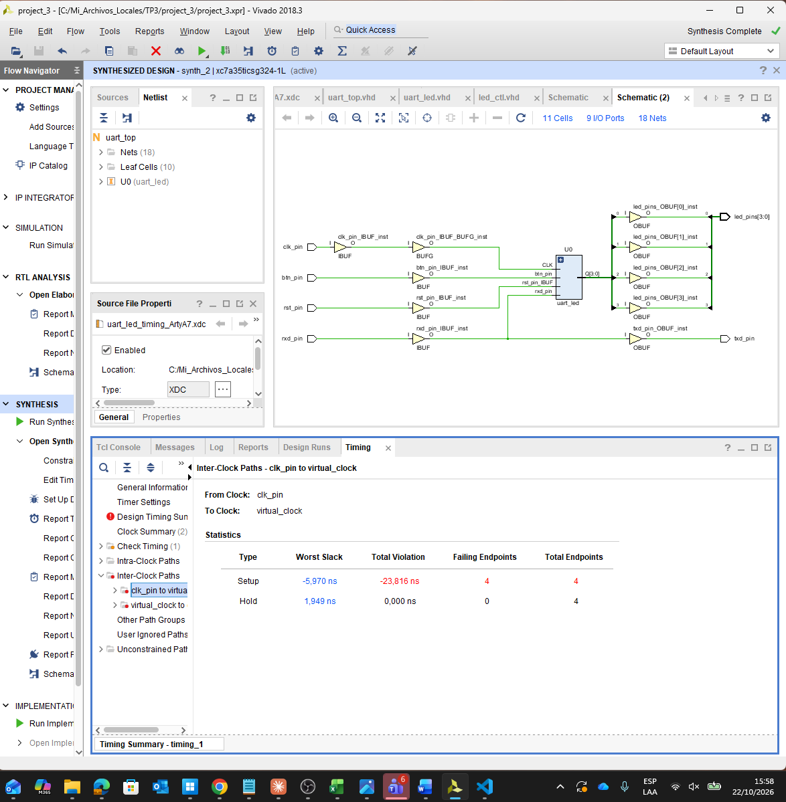
*Figura 2. Caminos entre relojes: las salidas fallan en setup y las entradas en hold.*

**¿Por qué fallan las salidas?** `clk_pin` tiene período de 10 ns y `virtual_clock` de 12 ns. Vivado analiza todos los pares de flancos dentro del mínimo común múltiplo (60 ns) y se queda con el más exigente: **lanzar en 10 ns y capturar en 12 ns**, un requisito de **2 ns** (Figura 3). Para las entradas, el peor par es 48 → 50 ns, también 2 ns.

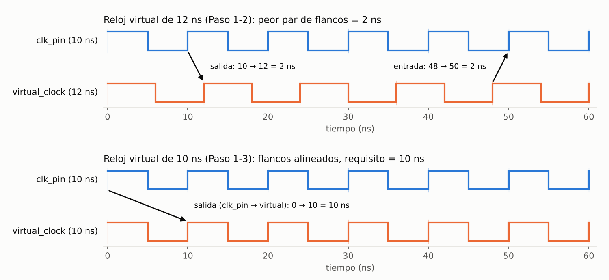
*Figura 3. Relación entre flancos. Con 12 ns el peor caso es 2 ns; con 10 ns los flancos coinciden y el requisito es un período completo.*

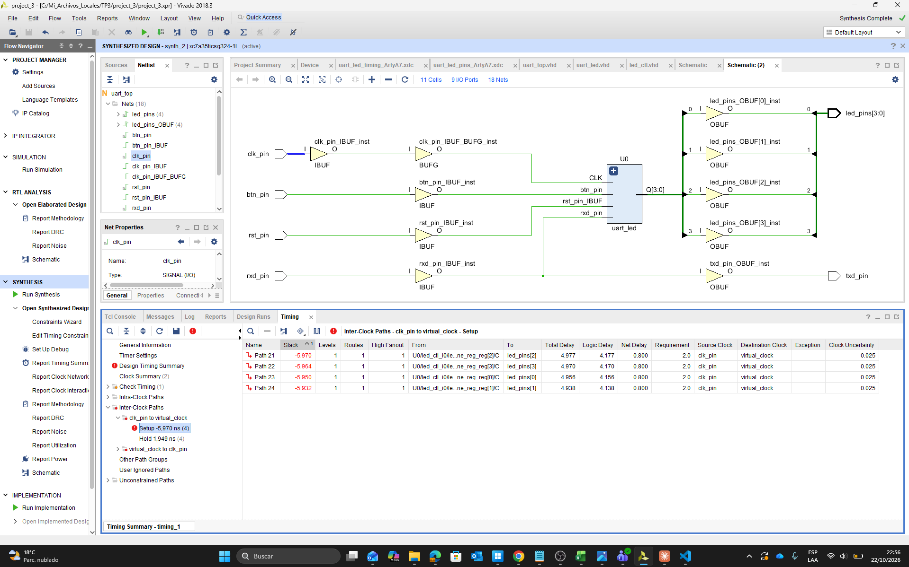
*Figura 4. Los cuatro caminos que fallan (Path 21 a 24): todos van del registro `led_pipeline_reg` de `led_ctl` al pad del LED.*

**Desglose del Path 21** (`led_pipeline_reg_reg[2]` → `led_pins[2]`):

| Tramo | A7-35 (este trabajo) | Z7-10 (enunciado) |
|---|---|---|
| Flanco de lanzamiento | 10,000 ns | 8,000 ns |
| *Source Clock Path* (IBUF + BUFG + red hasta el FF) | 2,968 ns ¹ | ≈ 2,968 ns |
| *Data Path* (clk→Q + red + OBUF) | 4,977 ns (lógica 4,177 + red 0,800) | ≈ 4,977 ns |
| **Arrival time** | **17,945 ns** | 15,945 ns |
| Required = 12 − 0,025 (incertidumbre) − 0 (output delay) | **11,975 ns** | 11,975 ns |
| **Slack** | **−5,970 ns** | −3,970 ns |

¹ Despejado de los valores del reporte: 17,945 − 10 − 4,977.

**El camino mide 7,945 ns en las dos placas.** La diferencia de 2 ns en el slack no se debe al hardware sino a dónde cae el flanco de lanzamiento: 10 → 12 ns (requisito 2 ns) en la A7 contra 8 → 12 ns (requisito 4 ns) en la Z7. Además, de los 4,977 ns del camino de datos, 4,177 son lógica, casi todo del **OBUF** (≈ 3,5 ns, salida LVCMOS33 lenta).

> En un camino de **salida**, el *Destination Clock Path* es el flanco ideal del reloj virtual (menos la incertidumbre y el output delay). El retardo del OBUF hasta el pad pertenece al *Data Path*.

### 3.4 Reloj virtual igual al reloj del sistema (1-3)

Con *Edit Timing Constraints* se cambió el período de `virtual_clock` de 12 a **10 ns** y se guardó en `uart_led_timing_ArtyA7.xdc` (*File → Constraints → Save*).

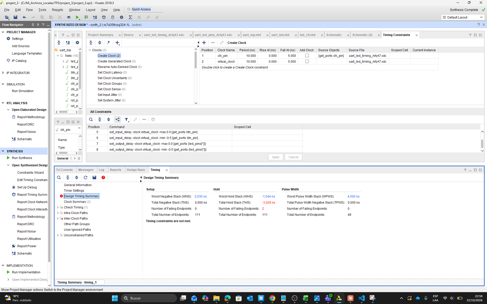
*Figura 5. Restricciones con ambos relojes de 10 ns; el setup se cumple, el hold de las entradas no.*

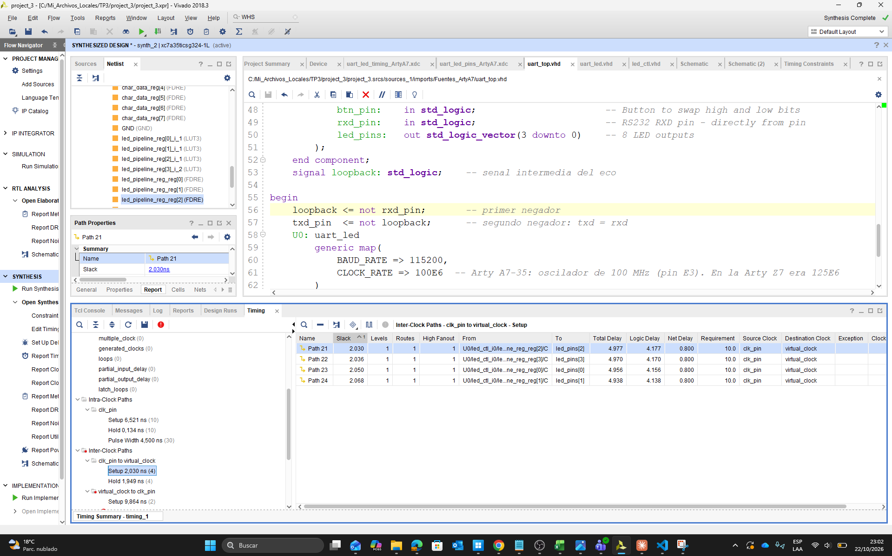
*Figura 6. Los mismos caminos ahora tienen requisito de 10 ns y slack positivo.*

| | Virtual 12 ns | **Virtual 10 ns** |
|---|---|---|
| Requisito de setup (salidas) | 2 ns | **10 ns** |
| WNS (LEDs) | −5,970 | **+2,030** (= 9,975 − 7,945) |
| Setup de entradas | +1,864 | **+9,864** |
| Setup intra-clock (`clk_pin`) | — | +6,521 → Fmax estimada ≈ 1 / 3,479 ns ≈ **287 MHz** |
| **WHS (rst, btn)** | −1,544 | **−1,544** (no cambia) |

**¿Por qué no mejora el hold?** El chequeo de hold se hace contra el **mismo flanco** (0 → 0 ns), y eso no depende del período.
- El dato de entrada llega muy temprano: input delay mínimo −0,5 ns + IBUF + red corta ≈ 0,5 ns.
- El reloj de captura llega tarde, porque atraviesa IBUF + BUFG + árbol de reloj (≈ 2 ns de **retardo de inserción**).
- El FF todavía está "cerrando" el valor anterior cuando llega el dato nuevo, y el slack da ≈ −1,5 ns.

---

## 4. Paso 2 — Implementación

### 4.1 Corrida de implementación (2-1)

Se reseteó `synth_2`, se cerró el diseño y se ejecutó **Run Implementation** (síntesis + `opt_design` + `place_design` + `route_design`). La implementación terminó con el *critical warning* esperado `[Timing 38-282]`, porque todavía no se cumplía el setup.

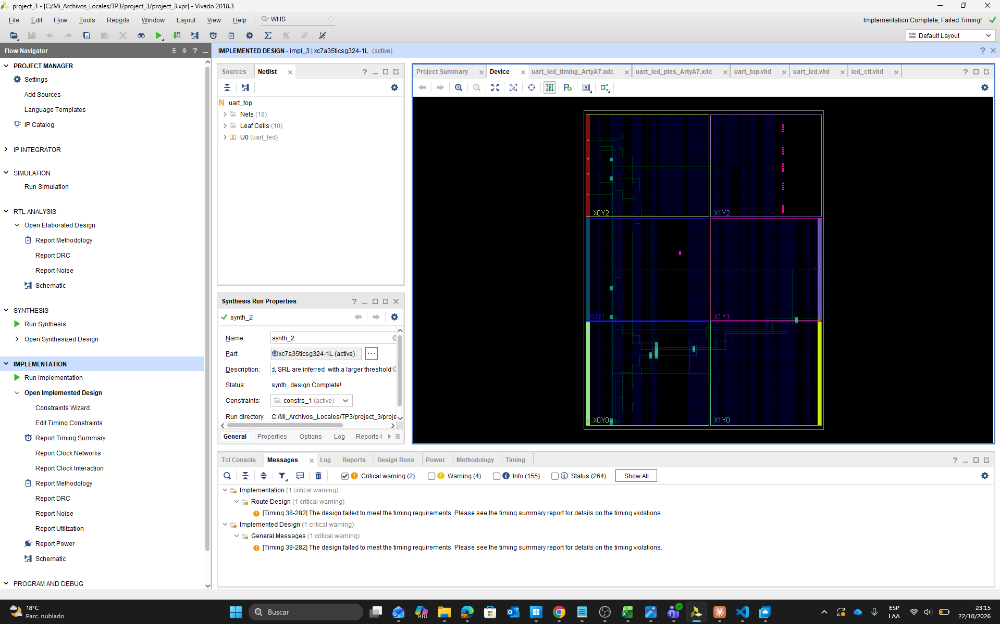
*Figura 7. Diseño implementado en el xc7a35t: **6 regiones de reloj** (X0Y0 a X1Y2; la Z7-010 del enunciado tiene 4). La lógica ocupa muy pocos slices, sobre todo en X0Y0.*

### 4.2 Utilización (2-2)

| Recurso | Usado | Disponible | % |
|---|---|---|---|
| Slice LUTs | 44 | 20 800 | 0,21 |
| Slice Registers (FF) | 48 | 41 600 | 0,12 |
| Slices | 19 | 8 150 | 0,23 |
| Bonded IOB | 9 | 210 | 4,29 |
| BUFGCTRL | 1 | 32 | 3,13 |

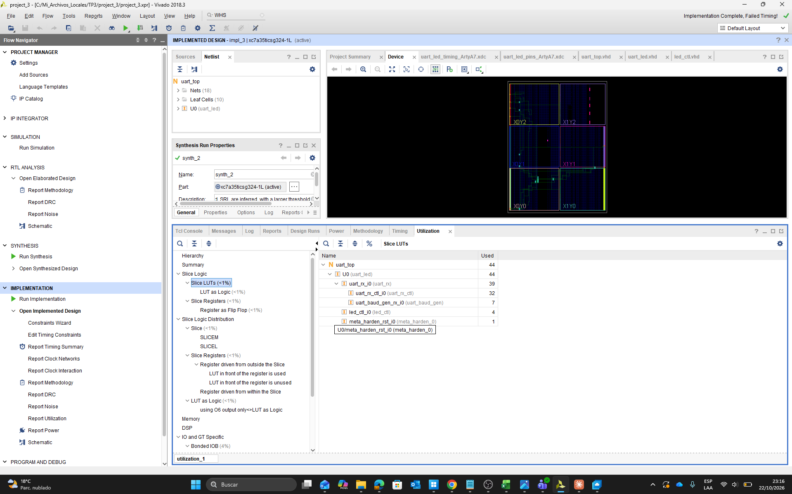
*Figura 8. LUTs por módulo: `uart_rx_ctl` 32, `uart_baud_gen` 7, `led_ctl` 4, `meta_harden_rst` 1. La jerarquía se conserva gracias a `rebuilt`.*

### 4.3 Timing post-ruteo (2-3-1 a 2-3-4)

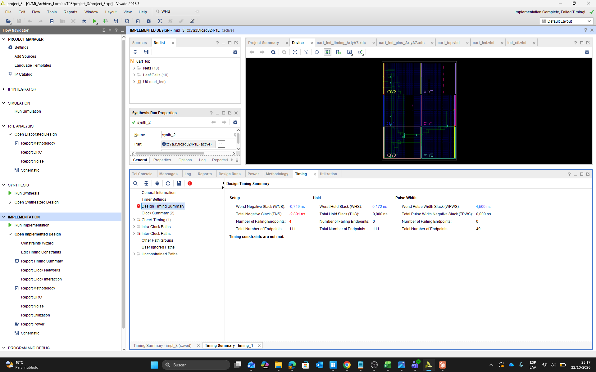
*Figura 9. Timing Summary después del ruteo: vuelve a fallar el setup de los LEDs, pero el hold se cumple.*

| | Post-síntesis (virtual 10 ns) | **Post-implementación** |
|---|---|---|
| WNS / TNS (LEDs) | +2,030 / 0 | **−0,749 / −2,891** (4 endpoints) |
| WHS / THS | −1,544 / −3,029 | **+0,172 / 0** |
| Setup intra-clock | +6,521 | +3,628 → Fmax ≈ 1 / 6,372 ns ≈ **157 MHz** |

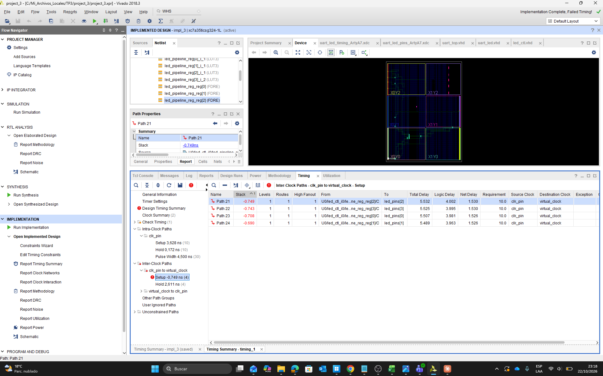
*Figura 10. Caminos de LED post-ruteo: el retardo de red pasó de 0,800 ns (estimado) a 1,530 ns (real).*

| Path 21 | Síntesis | Implementación |
|---|---|---|
| *Data Path* | 4,977 (lógica 4,177 + red 0,800) | 5,532 (lógica 4,002 + red 1,530) |
| *Source Clock Path* | 2,968 | ≈ 5,192 ¹ |
| Requisito | 10 | 10 |
| **Slack** | +2,030 | **−0,749** |

¹ Despejado: 9,975 + 0,749 − 5,532.

**Conclusiones del ruteo:**

1. **Lo que más empeora es el reloj, no el dato.** Con ruteo real, el reloj tarda ≈ 5,2 ns desde el pad E3 hasta el FF (síntesis estimaba ≈ 3 ns): +2,2 ns. El camino de datos solo creció 0,55 ns: la red aumentó y la lógica bajó un poco, porque el estimador de síntesis era pesimista con el OBUF.
2. **El hold de las entradas se resolvió en el ruteo.** Pasó de −1,544 ns a positivo por dos razones:
   - se usan los retardos reales del IBUF y de la red de entrada;
   - `route_design` hace **hold fixing**: alarga el ruteo del dato. Como esas entradas tienen ~9,9 ns de margen de setup, puede hacerlo sin romper nada.

   En la corrida final esto se ve en el camino `rst_pin → meta_harden_rst/signal_meta_reg` (sección 5.1): 2,656 ns de ruteo, el 92 % del camino.

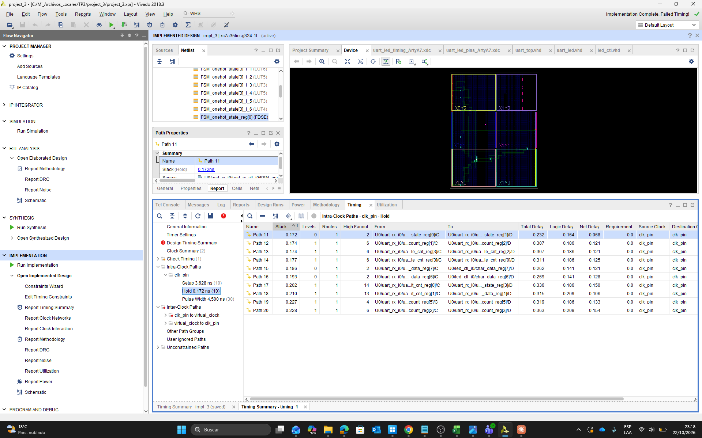
*Figura 11. El peor hold del diseño (+0,172 ns) es un camino interno de la FSM.*

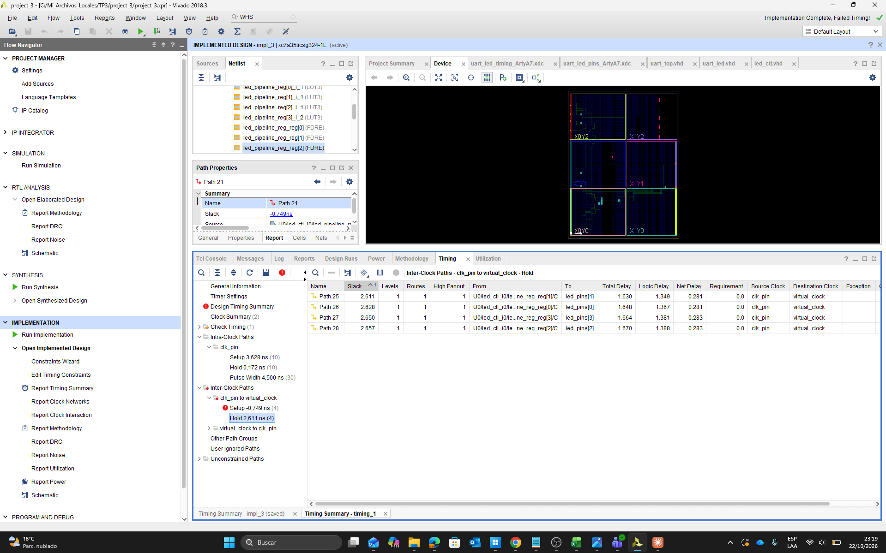
*Figura 12. Hold de las salidas con holgura (+2,6 ns).*

### 4.4 Output delay de −4 ns (2-3-5 a 2-3-7)

Como el retraso de unos pocos ns en un LED es imperceptible, se relajó el `set_output_delay -max` de `led_pins` de 0 a **−4 ns**. El tiempo requerido pasa de 9,975 a **13,975 ns** y el slack de los LEDs pasa a −0,749 + 4 = **+3,251 ns**.

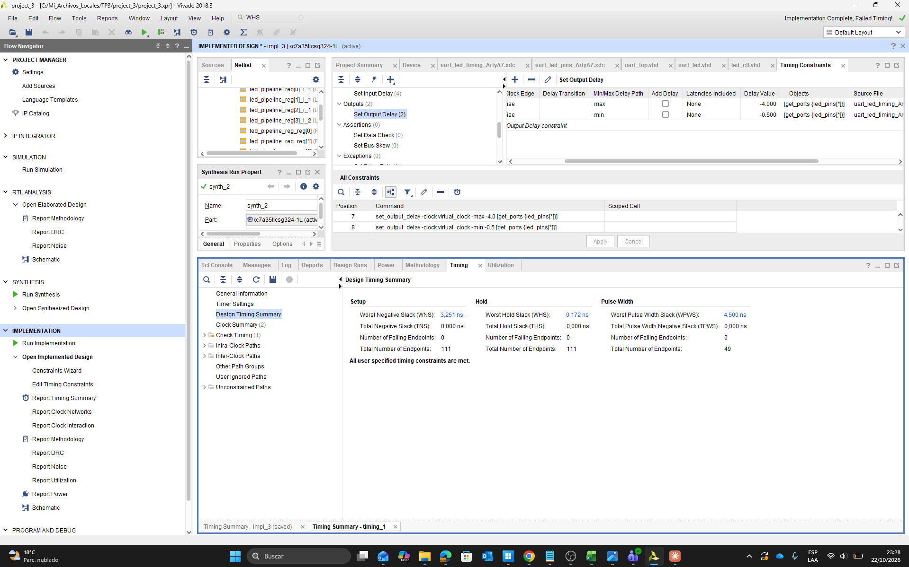
*Figura 13. Con output delay máximo de −4 ns: WNS +3,251, WHS +0,172, "All user specified timing constraints are met".*

> Un output delay negativo equivale a decir que el dispositivo externo captura 4 ns *después* del flanco del reloj. Para un LED es aceptable porque nadie lo "captura"; la forma más correcta de expresarlo sería `set_false_path -to [get_ports led_pins*]`, que corresponde al TP5.

### 4.5 Caminos intra-reloj y redes de reloj (2-3-8 a 2-3-11)

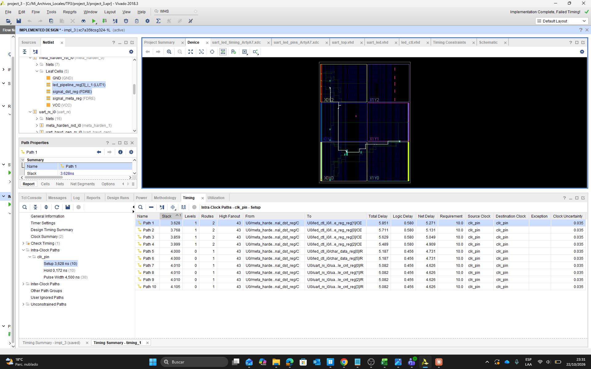
*Figura 14. Los 10 peores caminos de `clk_pin` y el ruteo del peor (en blanco) en la vista Device.*

El peor camino interno sale del **reset sincronizado** (`meta_harden_rst_i0/signal_dst_reg`, **fanout 43**) y llega a la entrada CE de `led_pipeline_reg` a través de un LUT1. Mide 5,851 ns, de los cuales **5,271 ns (90 %) son ruteo**: el reset llega a casi toda la lógica, y la red recorre varias regiones del dispositivo. Si hiciera falta mejorarlo, se podría duplicar el registro de reset (`MAX_FANOUT`) o usar un BUFG para el reset.

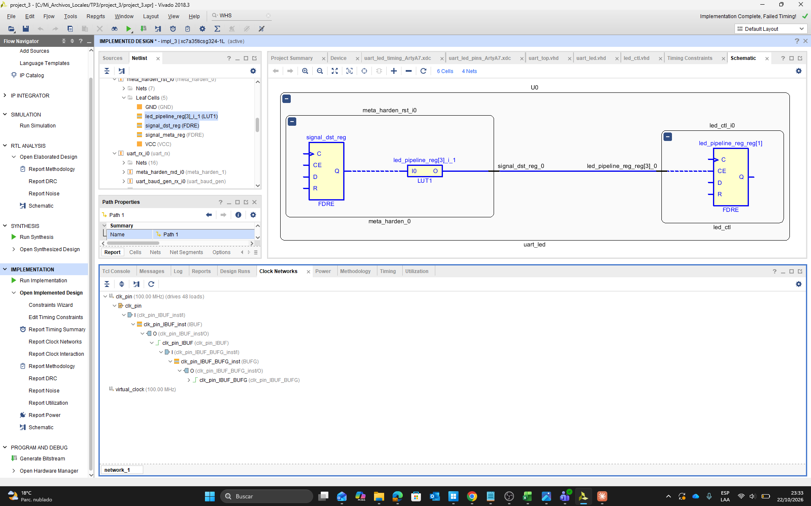
*Figura 15. Esquemático del peor camino (`signal_dst_reg` → LUT1 → CE de `led_pipeline_reg`) y reporte **Clock Networks**: `clk_pin` (100 MHz) → IBUF → BUFG → 48 cargas; `virtual_clock` (100 MHz) no tiene red física.*

---

## 5. Paso 3 — Generación del bitstream

Se guardaron las restricciones modificadas en `uart_led_timing_ArtyA7.xdc` (Anexo A) y se ejecutó **Generate Bitstream**. Como cambiaron las restricciones, Vivado volvió a correr síntesis e implementación y generó `project_3.runs\impl_3\uart_top.bit`.

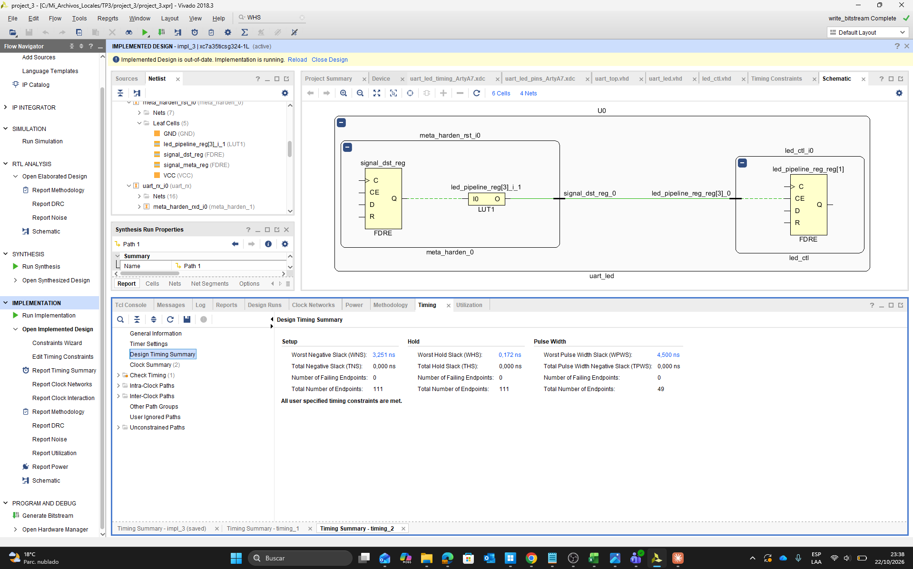
*Figura 16. `write_bitstream Complete` y timing cumplido.*

### 5.1 Timing de la corrida final (la que va a la placa)

Valores tomados de `uart_top_timing_summary_routed.rpt`:

| | Valor |
|---|---|
| **WNS** | **+1,444 ns** (`led_pins[3]` → T10) |
| **WHS** | **+0,134 ns** |
| Setup intra-clock | +4,918 ns |
| Entradas (virtual → clk_pin) | setup +6,833 ns / hold +0,201 ns |
| Fallas | 0 — *All user specified timing constraints are met* |

**Peor camino de setup final:**

```
Source:      U0/led_ctl_i0/led_pipeline_reg_reg[3]/C   (clk_pin)
Destination: led_pins[3]                                (virtual_clock)
  E3   IBUF (clk_pin)                     1.489   1.489
       net                                1.967   3.455
       BUFG                               0.096   3.551
       net (fo=48)                        1.625   5.176   <- reloj en el FF
       FDRE clk->Q                        0.456   5.632
       net                                3.359   8.991
  T10  OBUF                               3.539  12.531   <- arrival time
  required = 10.000 - 0.025 + 4.000 =            13.975
  slack                                           1.444
```

**¿Por qué el WNS final (+1,444) es menor que el obtenido en memoria (+3,251)?** Al generar el bitstream se hizo un place & route nuevo, ya con la restricción relajada. El placer es *timing-driven*: como el camino ya cumplía, no necesitó acercar el FF del LED al pad. Lo dejó en `SLICE_X1Y52`, a 3,36 ns de ruteo de T10.

**Peor camino de hold final (hold fixing visible):**

```
Source:      rst_pin (virtual_clock, input delay -0.5)
Destination: U0/meta_harden_rst_i0/signal_meta_reg/D
  input delay                            -0.500  -0.500
  D9 IBUF                                 0.235  -0.265
  net (routed)                            2.656   2.391   <- ruteo alargado por el router
  reloj de captura (IBUF+BUFG+red)                 2.095
  + incertidumbre + hold del FF                    2.190   <- required
  slack                                            0.201
```

### 5.2 Evolución del camino crítico de salida

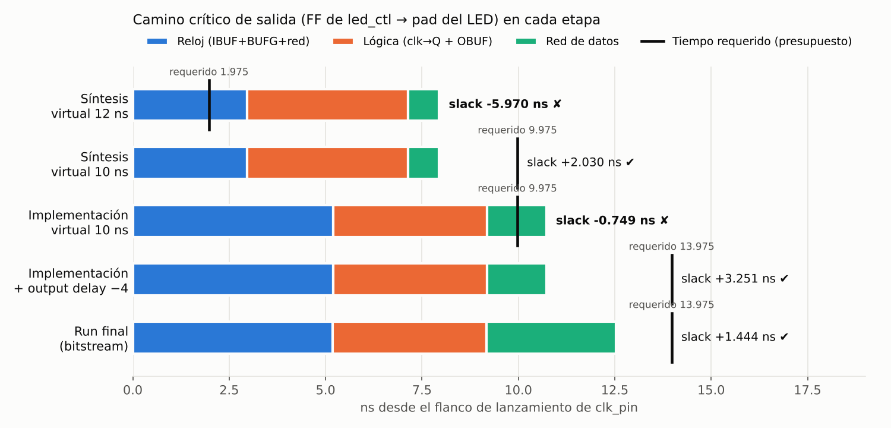
*Figura 17. Composición del camino FF de `led_ctl` → pad del LED en cada etapa (reloj, lógica y red) contra el tiempo requerido.*

| Etapa | Reloj | Lógica | Red | Requerido | Slack |
|---|---|---|---|---|---|
| Síntesis, virtual 12 ns | 2,968 | 4,177 | 0,800 | 1,975 | −5,970 |
| Síntesis, virtual 10 ns | 2,968 | 4,177 | 0,800 | 9,975 | +2,030 |
| Implementación, virtual 10 ns | 5,192 | 4,002 | 1,530 | 9,975 | −0,749 |
| Implementación + output delay −4 | 5,192 | 4,002 | 1,530 | 13,975 | +3,251 |
| **Run final (bitstream)** | 5,176 | 3,995 | 3,359 | 13,975 | **+1,444** |

### 5.3 Otros reportes de la corrida final

- **Potencia:** 66 mW en total (62 mW estáticos, 4 mW dinámicos), temperatura de juntura 25,3 °C.
- **Methodology:** una sola advertencia, `TIMING-18` (*Missing input delay*), porque `rxd_pin` no tiene `set_input_delay`. Es esperable: el XDC de la cátedra no lo restringe y la UART se sincroniza con `meta_harden`.
- **DRC:** sin errores.

---

## 6. Conclusiones

1. **El timing de I/O depende de las restricciones tanto como del hardware.** El mismo camino de 7,945 ns falla por −5,97 ns o cumple con +2,03 ns según la relación entre los relojes (requisito de 2 ns o de 10 ns).
2. **La síntesis subestima el reloj.** El retardo de inserción real (≈ 5,2 ns) casi duplica la estimación post-síntesis (≈ 3 ns), y eso hizo fallar de nuevo los LEDs después del ruteo.
3. **Los problemas de hold en las entradas los resuelve el router**, alargando el ruteo del dato cuando hay margen de setup. Por eso una violación de hold post-síntesis no siempre indica un problema real.
4. **En este diseño el camino crítico real es de I/O (OBUF ≈ 3,5 ns), no de lógica.** La lógica interna funcionaría a ≈ 157 MHz, y el peor camino interno es el reset sincronizado de fanout 43, dominado por el ruteo (≈ 90 %).
5. **Relajar una restricción cambia el resultado del place & route.** El WNS final (+1,444) es menor que el calculado en memoria (+3,251) porque el placer dejó de priorizar ese camino.

### Observación sobre `led_ctl.vhd`

La línea `led_o <= led_pipeline_reg;` está dentro del process pero fuera del `rising_edge`, y `led_pipeline_reg` no tiene reset. Por eso:
- síntesis da un warning de lista de sensibilidad incompleta;
- la asignación `led_o <= "0000"` del reset queda pisada.

Por lo tanto, **mientras BTN0 está apretado los LEDs mantienen el último valor y se apagan recién al soltar el reset** (`char_data` ya vale 0 y se copia al pipeline en el siguiente ciclo). Este comportamiento se verificó en la placa (sección 7).

---

## 7. Paso 4 — Verificación en la placa

### 7.1 Conexión y programación (4-1)

La placa se conectó a la PC con un único cable micro-USB en **J10 (PROG/UART)**: el FT2232 de la Arty A7 expone por el mismo cable el JTAG y un puerto COM virtual, por lo que no fue necesario el adaptador USB-serie del enunciado. Desde *Open Hardware Manager → Open Target → Auto Connect* se detectó el dispositivo **`xc7a35t_0`** y se programó con `project_3.runs\impl_3\uart_top.bit` (*Program Device*). El LED **DONE** se encendió al finalizar la configuración.

### 7.2 Terminal (4-2-1 a 4-2-3)

Se abrió TeraTerm sobre el puerto COM de la placa con **115200 baud, 8 bits de datos, sin paridad, 1 bit de stop y sin control de flujo**, y con el *local echo* desactivado, de modo que cada carácter que aparece en pantalla es el eco devuelto por la FPGA.

### 7.3 Pruebas (4-2-4 y 4-2-5)

LEDs: `led_pins[3..0]` = **LD7 LD6 LD5 LD4** (● encendido, ○ apagado).

| Tecla | ASCII | Binario | BTN1 suelto (nibble bajo) | BTN1 apretado (nibble alto) | Eco | LEDs |
|---|---|---|---|---|---|---|
| `A` | 0x41 | 0100 0001 | ○○○● (0001) | ○●○○ (0100) | ✔ | ✔ |
| `a` | 0x61 | 0110 0001 | ○○○● (0001) | ○●●○ (0110) | ✔ | ✔ |
| `0` | 0x30 | 0011 0000 | ○○○○ (0000) | ○○●● (0011) | ✔ | ✔ |
| `5` | 0x35 | 0011 0101 | ○●○● (0101) | ○○●● (0011) | ✔ | ✔ |
| `U` | 0x55 | 0101 0101 | ○●○● (0101) | ○●○● (0101) | ✔ | ✔ |
| `z` | 0x7A | 0111 1010 | ●○●○ (1010) | ○●●● (0111) | ✔ | ✔ |
| `~` | 0x7E | 0111 1110 | ●●●○ (1110) | ○●●● (0111) | ✔ | ✔ |

- Cada carácter tipeado apareció **una sola vez** en la terminal (eco por `txd_pin`) y los LEDs mostraron el **nibble bajo**.
- Al mantener apretado **BTN1** los LEDs pasaron al **nibble alto** del último carácter recibido, y volvieron al nibble bajo al soltarlo.
- Con **BTN0** (reset) apretado los LEDs mantuvieron el último valor y se apagaron al soltarlo, como se anticipó en la sección 6.

### 7.4 Cierre (4-2-6 y 4-2-7)

Se cerró el Hardware Manager (*File → Close Hardware Manager*) y luego la terminal, antes de desconectar la placa.

---

## Anexo A — Restricciones finales

**`uart_led_timing_ArtyA7.xdc`**

```tcl
create_clock -period 10.000 -name clk_pin -waveform {0.000 5.000} [get_ports clk_pin]

create_clock -period 10.000 -name virtual_clock -waveform {0.000 5.000}

set_input_delay -clock virtual_clock -max 0.000 [get_ports rst_pin]
set_input_delay -clock virtual_clock -min -0.500 [get_ports rst_pin]

set_input_delay -clock virtual_clock -max 0.000 [get_ports btn_pin]
set_input_delay -clock virtual_clock -min -0.500 [get_ports btn_pin]

set_output_delay -clock virtual_clock -max -4.000 [get_ports {led_pins[*]}]
set_output_delay -clock virtual_clock -min -0.500 [get_ports {led_pins[*]}]
```

**`uart_led_pins_ArtyA7.xdc`**

```tcl
set_property -dict {PACKAGE_PIN E3 IOSTANDARD LVCMOS33} [get_ports clk_pin]
set_property -dict {PACKAGE_PIN D9 IOSTANDARD LVCMOS33} [get_ports rst_pin]
set_property -dict {PACKAGE_PIN C9 IOSTANDARD LVCMOS33} [get_ports btn_pin]
set_property -dict {PACKAGE_PIN A9 IOSTANDARD LVCMOS33} [get_ports rxd_pin]
set_property -dict {PACKAGE_PIN H5 IOSTANDARD LVCMOS33} [get_ports {led_pins[0]}]
set_property -dict {PACKAGE_PIN J5 IOSTANDARD LVCMOS33} [get_ports {led_pins[1]}]
set_property -dict {PACKAGE_PIN T9 IOSTANDARD LVCMOS33} [get_ports {led_pins[2]}]
set_property -dict {PACKAGE_PIN T10 IOSTANDARD LVCMOS33} [get_ports {led_pins[3]}]
set_property CFGBVS VCCO [current_design]
set_property CONFIG_VOLTAGE 3.3 [current_design]
set_property -dict {PACKAGE_PIN D10 IOSTANDARD LVCMOS33} [get_ports txd_pin]
```
