# TP4 — Uso del Catálogo de IP (Clocking Wizard)

**Sistemas Digitales (66.17 / 86.41) · Taller de Sistemas Digitales (TA147) — FIUBA**
**Alumno:** Aleksey Chahuillco · **Padrón:** 110929

| Herramienta | Placa / dispositivo | Proyecto |
|---|---|---|
| Vivado 2018.3 | Digilent **Arty A7-35** — `xc7a35ticsg324-1L` | `TP4\Practica04` (runs `synth_1` / `impl_1`) |

---

## 1. Objetivo

Usar el **IP Catalog** de Vivado para generar un recurso de temporización: un **MMCM** configurado con el *Clocking Wizard*. El MMCM genera un reloj de **50 MHz** a partir del oscilador de la placa, y ese reloj alimenta al receptor UART del TP2/TP3 sin cambiar sus parámetros de temporización (115200 baudios).

El sistema es el mismo de la práctica 3: una UART que muestra en 4 LEDs el nibble bajo del carácter recibido (el alto con el botón apretado) y devuelve cada carácter por `txd_pin` (eco).

---

## 2. Adaptación del enunciado (Arty Z7-10) a la Arty A7-35

| Paso | Enunciado (Z7-10) | Implementado (A7-35) | Motivo |
|---|---|---|---|
| 1-2 | `clk_pin` de 8 ns (125 MHz) | **10 ns (100 MHz)** | Oscilador de la A7 (pin E3) |
| 1-2 | Reloj virtual de 20 ns | **20 ns** (igual) | Es el período del reloj de 50 MHz del MMCM |
| 1-2 | Output delay máx. 0 ns | **0 ns** (igual, sin el −4 del TP3) | |
| 1-2-1 | `txd_pin` en Y19 (Pmod JA) | **D10** (`uart_rxd_out`) | USB-UART integrado en la placa |
| 1-2-3 | Intercambio de nibbles en `led_ctl` | Igual (viene del TP3) | |
| 2-1-3 | `clk_in1` = 125 MHz | **`clk_in1` = 100 MHz** | |
| 2-1-4 | `clk_out1` = 50 MHz | **50 MHz** (igual) | |
| 2-2-2 | Agregar `clk_wiz_0_stub.vhdl` como fuente | **No se agregó** | El IP (`.xci`) ya aporta el módulo. El *stub* es una caja negra y sumarlo como fuente puede duplicar la entidad `clk_wiz_0`; alcanza con la declaración `component` |
| 4 | micro-USB + adaptador en JA | **Solo micro-USB (J10)**; BTN1 = nibble, BTN0 = reset | Igual que en el TP3 |

Con 50 MHz el divisor del generador de baudios queda en (50·10⁶ + 921 600) / (115 200 · 16) = **27**, que da 50·10⁶ / (27 · 16) ≈ **115 741 bps**. Es el mismo baud que antes: el divisor se reduce a la mitad (de 54 a 27).

### Pines (`uart_led_pins_ArtyA7.xdc`, sin cambios respecto del TP3)

| Puerto | Pin | Recurso | Puerto | Pin | Recurso |
|---|---|---|---|---|---|
| `clk_pin` | E3 | Oscilador 100 MHz | `txd_pin` | D10 | `uart_rxd_out` |
| `rst_pin` | D9 | BTN0 | `led_pins[0..1]` | H5, J5 | LD4, LD5 |
| `btn_pin` | C9 | BTN1 | `led_pins[2..3]` | T9, T10 | LD6, LD7 |
| `rxd_pin` | A9 | `uart_txd_in` | | | |

---

## 3. Paso 1 — Crear el proyecto

Se creó el proyecto `Practica04` (RTL Project, VHDL) con los siete `.vhd` y los dos `.xdc` de `TP4\Fuentes_ArtyA7`, que parten de las fuentes del TP3. La estrategia de síntesis es **Vivado Synthesis Defaults** (`flatten_hierarchy = rebuilt`).

**Restricciones de temporización (`uart_led_timing_ArtyA7.xdc`):**

```tcl
create_clock -period 10.000 -name clk_pin -waveform {0.000 5.000} [get_ports clk_pin]

create_clock -period 20.000 -name virtual_clock

set_input_delay -clock virtual_clock -max 0.000 [get_ports rst_pin]
set_input_delay -clock virtual_clock -min -0.500 [get_ports rst_pin]

set_input_delay -clock virtual_clock -max 0.000 [get_ports btn_pin]
set_input_delay -clock virtual_clock -min -0.500 [get_ports btn_pin]

set_output_delay -clock virtual_clock -max 0.000 [get_ports {led_pins[*]}]
set_output_delay -clock virtual_clock -min -0.500 [get_ports {led_pins[*]}]
```

**Cambios en `uart_top.vhd` (1-2-2):** la UART pasa a usar el reloj de 50 MHz.

```vhdl
	U0: uart_led
		generic map(
			BAUD_RATE  => 115200,
			CLOCK_RATE => 50E6
		)
		port map(
			clk_pin  => clk50,
			...
```

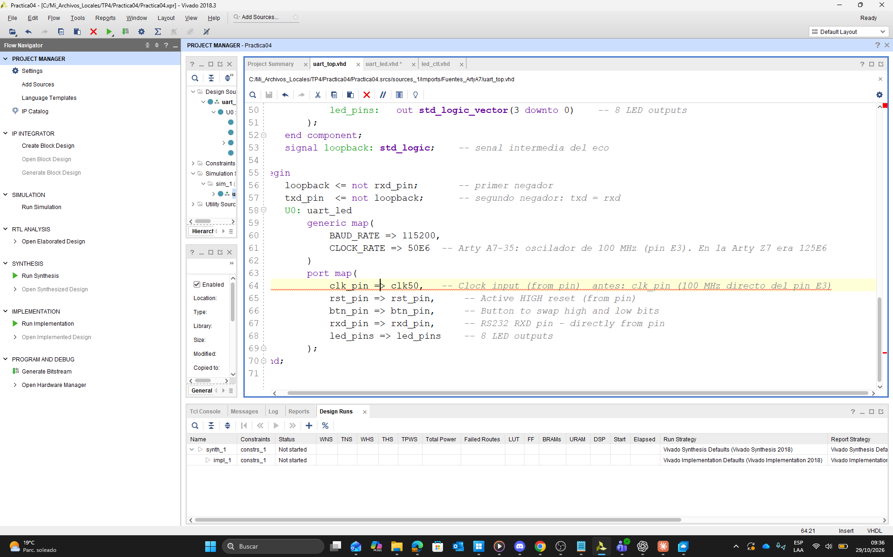
*Figura 1. Proyecto creado y `uart_top.vhd` modificado. El error en `clk50` es esperable: la señal se declara en el paso 2.*

---

## 4. Paso 2 — Agregar el IP del catálogo

### 4.1 Configuración del Clocking Wizard (2-1)

Desde **IP Catalog → FPGA Features and Design → Clocking → Clocking Wizard** se generó `clk_wiz_0`.

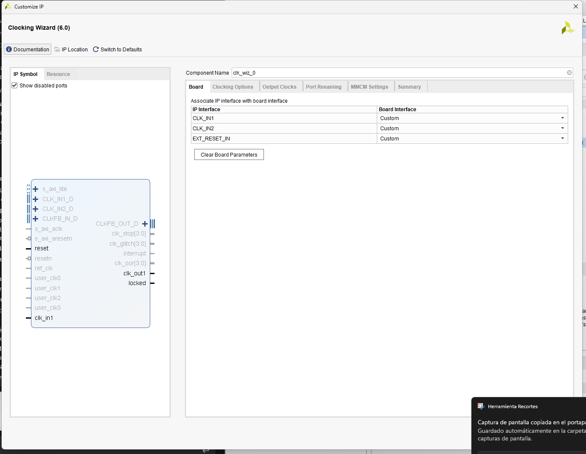
*Figura 2. Pestaña Board: `CLK_IN1` y `EXT_RESET_IN` en **Custom**. Así el IP no agrega su propia restricción de pin, que chocaría con el XDC.*

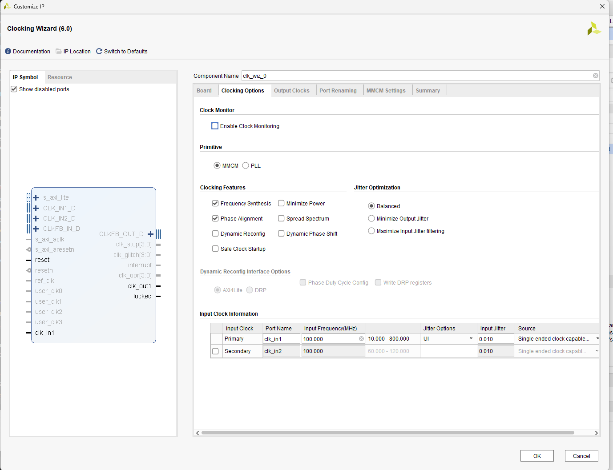
*Figura 3. Clocking Options: primitiva **MMCM**, *Frequency Synthesis* y *Phase Alignment* activos, `clk_in1` = **100 MHz**, *Single ended clock capable pin*.*

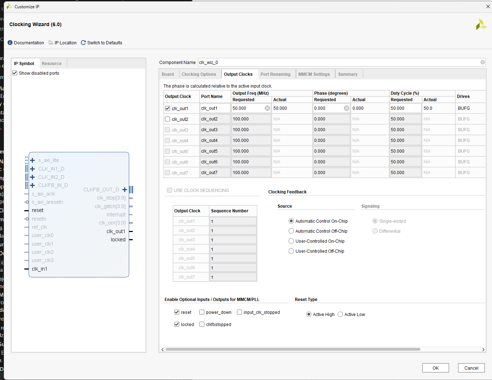
*Figura 4. Output Clocks: `clk_out1` = **50 MHz** (*actual* 50,000), fase 0°, ciclo de trabajo 50 %, salida por **BUFG**. Se habilitan `reset` (activo en alto) y `locked`, con realimentación *Automatic Control On-Chip*.*

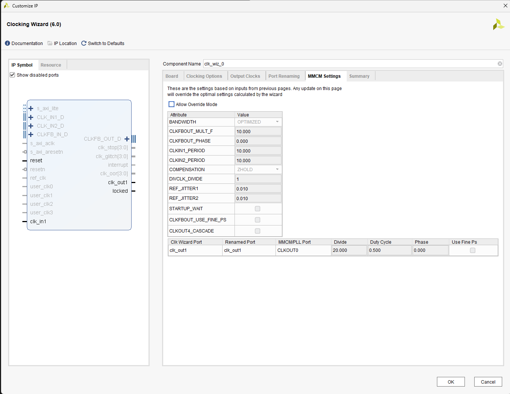
*Figura 5. Parámetros calculados por el wizard.*

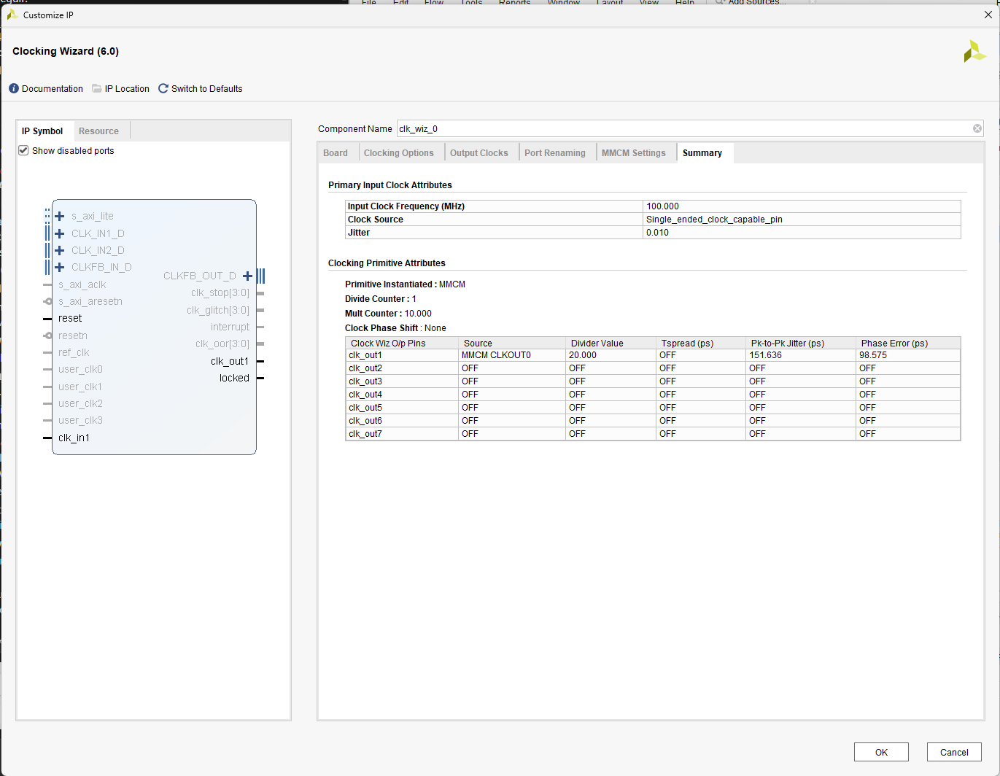
*Figura 6. Resumen: jitter y error de fase de `clk_out1`.*

| Parámetro | Valor | Significado |
|---|---|---|
| `CLKIN1_PERIOD` | 10,000 ns | Entrada de 100 MHz |
| `DIVCLK_DIVIDE` (D) | 1 | Divisor de entrada |
| `CLKFBOUT_MULT_F` (M) | 10,000 | f_VCO = 100 MHz · M / D = **1000 MHz** (rango del MMCM −1: 600 a 1200 MHz) |
| `CLKOUT0_DIVIDE_F` (O) | 20,000 | f_out = f_VCO / O = **50 MHz** |
| `COMPENSATION` | **ZHOLD** | Compensa el retardo de inserción del reloj (sección 5.3) |
| Jitter pico a pico (`clk_out1`) | 151,636 ps | |
| Error de fase (`clk_out1`) | 98,575 ps | |

**Fórmula:** f_out = f_in · M / (D · O) = 100 MHz · 10 / (1 · 20) = 50 MHz.

Al apretar **Generate** con la opción *Out of context per IP*, Vivado sintetiza el IP por separado, en la corrida `clk_wiz_0_synth_1`.

### 4.2 Instanciación en `uart_top.vhd` (2-2)

La declaración del componente se copió de la plantilla de instanciado `clk_wiz_0.vho` (*IP Sources → Instantiation Template*).

```vhdl
architecture uart_top_arq of uart_top is
	component clk_wiz_0 is
		port(
			clk_out1 : out std_logic;
			reset    : in  std_logic;
			locked   : out std_logic;
			clk_in1  : in  std_logic
		);
	end component;
	...
	signal loopback: std_logic;
	signal clk50:    std_logic;

begin
	loopback <= not rxd_pin;
	txd_pin  <= not loopback;

	clk0: clk_wiz_0
		port map(
			clk_out1 => clk50,
			reset    => rst_pin,
			locked   => open,
			clk_in1  => clk_pin
		);
```

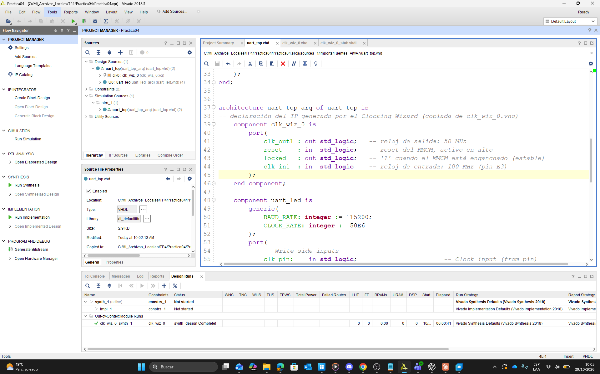
*Figura 7. `clk0 : clk_wiz_0 (clk_wiz_0.xci)` dentro de `uart_top`, y la corrida *Out-of-Context* `clk_wiz_0_synth_1` completa.*

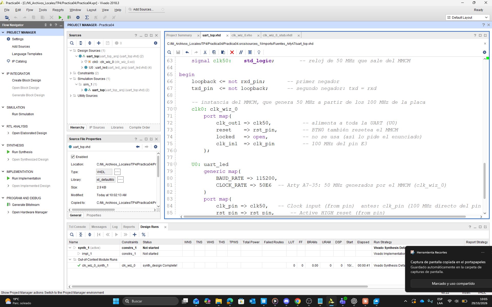
*Figura 8. Instancia del MMCM y de la UART con `CLOCK_RATE => 50E6` y `clk_pin => clk50`.*

### 4.3 Diseño elaborado (2-2-6)

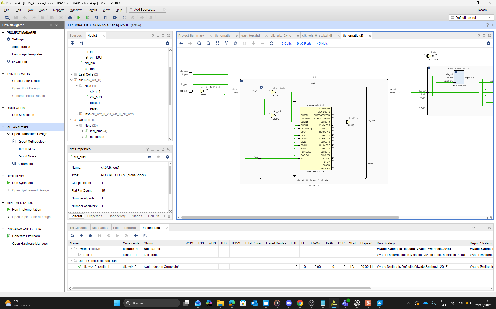
*Figura 9. Esquemático elaborado. Dentro de `clk0/inst` se ve la estructura que genera el wizard: `clkin1_ibufg` (IBUF) → **MMCME2_ADV** → `clkout1_buf` (BUFG) → `clk_out1`, y el lazo de realimentación `CLKFBOUT → clkf_buf (BUFG) → CLKFBIN`. `rst_pin` llega a la entrada `RST` del MMCM y también a la UART.*

---

## 5. Paso 3 — Implementación

### 5.1 Mensajes

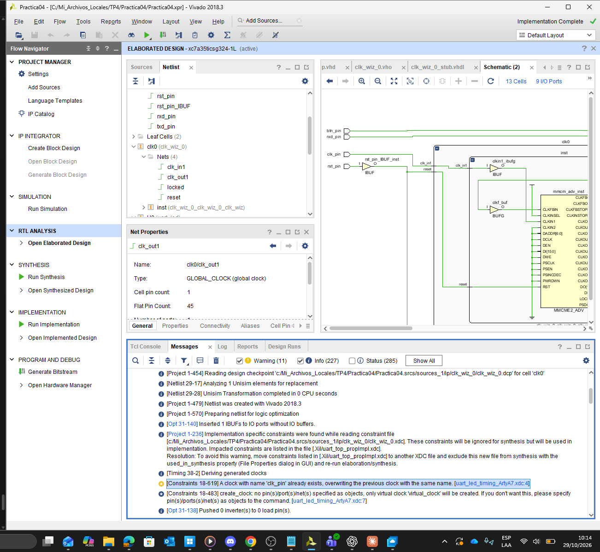
*Figura 10. Mensajes de la implementación.*

| Mensaje | Explicación |
|---|---|
| `[Constraints 18-619]` *A clock with name 'clk_pin' already exists, overwriting…* | El XDC del IP (`clk_wiz_0.xdc`) ya define `create_clock -period 10.000 [get_ports clk_in1]`, que en el top es `clk_pin`; el `create_clock` del XDC propio lo reemplaza con el mismo período |
| `[Constraints 18-483]` *only virtual clock 'virtual_clock' will be created* | Es lo buscado: el reloj virtual no tiene objeto físico |
| `[Project 1-236]` *Implementation specific constraints…* | Restricciones del IP que solo se aplican en implementación |
| Methodology `XDCC-1` / `XDCC-7` | Mismo origen que el 18-619: se pisa un reloj definido por el IP |
| Methodology `TIMING-18` | `rxd_pin` sin input delay (igual que en el TP3) |

> **Observación:** al pisar el reloj del IP también se pierde el `set_input_jitter 0.1` que define su XDC; por eso la incertidumbre del reloj no incluye *input jitter* (TIJ). La práctica recomendada es no redefinir un reloj que ya define el IP (o volver a declarar el jitter). Es un tema del TP5 (restricciones).

### 5.2 Timing post-ruteo

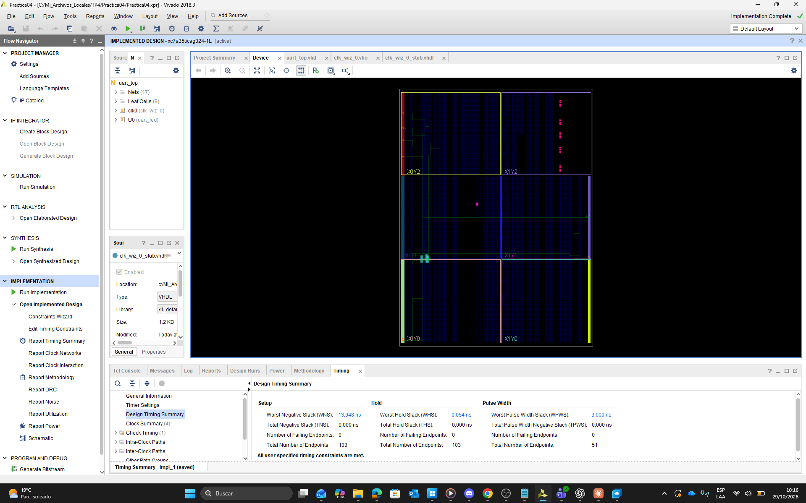
*Figura 11. Diseño implementado: **todas las restricciones se cumplen**, sin modificar ninguna.*

| | TP3 (sin MMCM, run final) | **TP4 (con MMCM)** |
|---|---|---|
| WNS | +1,444 ns (con output delay −4) | **+13,048 ns** (output delay 0) |
| WHS | +0,134 ns | **+0,054 ns** |
| WPWS | +4,500 ns | +3,000 ns |
| Endpoints de timing | 111 | 103 |
| Fallas | 0 | **0** |

| Grupo de caminos | Setup | Hold |
|---|---|---|
| `clk_out1` → `clk_out1` (lógica interna) | +16,127 | +0,054 |
| `virtual_clock` → `clk_out1` (entradas rst, btn) | +13,629 | **+1,530** |
| `clk_out1` → `virtual_clock` (salidas LED) | **+13,048** | +1,244 |

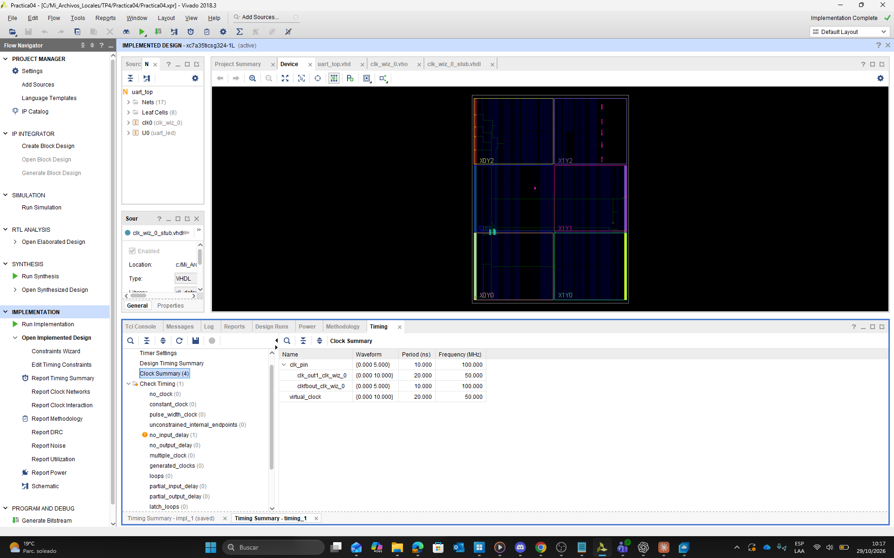
*Figura 12. Clock Summary: cuatro relojes. `clk_out1_clk_wiz_0` (20 ns) y `clkfbout_clk_wiz_0` (10 ns) son **relojes generados** que Vivado deriva automáticamente del MMCM a partir de `clk_pin`; no hizo falta escribir `create_generated_clock`.*

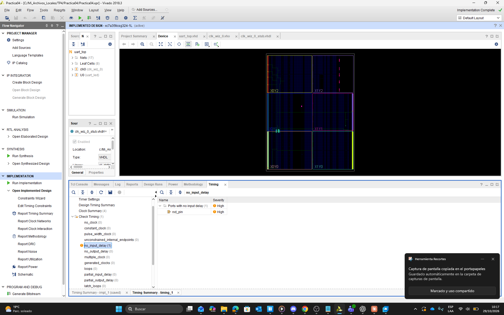
*Figura 13. Check Timing: solo `rxd_pin` sin input delay.*

### 5.3 Efecto del MMCM sobre el reloj (compensación ZHOLD)

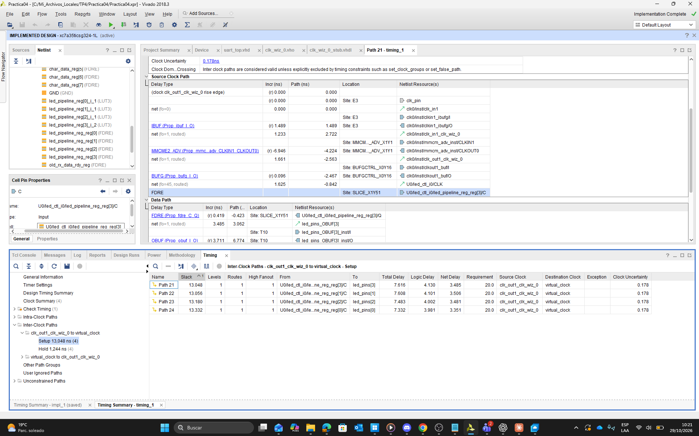
*Figura 14. Camino del LED 3: el MMCM aporta un retardo **negativo** de −6,946 ns.*

**Camino del LED 3 (`led_pipeline_reg_reg[3]` → `led_pins[3]`), peor caso lento:**

```
  E3   IBUF (clkin1_ibufg)              1.489   1.489
       net                              1.233   2.722
       MMCME2_ADV (CLKIN1 -> CLKOUT0)  -6.946  -4.224   <- compensación ZHOLD
       net                              1.661  -2.563
       BUFG (clkout1_buf)               0.096  -2.467
       net (fo=45)                      1.625  -0.842   <- el reloj llega al FF ANTES que al pad
       FDRE clk->Q                      0.419  -0.423
       net                              3.485   3.062
  T10  OBUF                             3.711   6.774   <- arrival time
  required = 20.000 - 0.178 (incertidumbre) - 0 (output delay) = 19.822
  slack                                        13.048
```

El MMCM usa el lazo de realimentación (`CLKFBOUT → BUFG → CLKFBIN`) para generar una salida **adelantada**. Ese adelanto cancela el retardo del IBUF y del árbol de reloj. Con `COMPENSATION = ZHOLD`, el flanco llega a los flip-flops prácticamente alineado con el flanco en el pad; en este caso, **0,84 ns antes**.

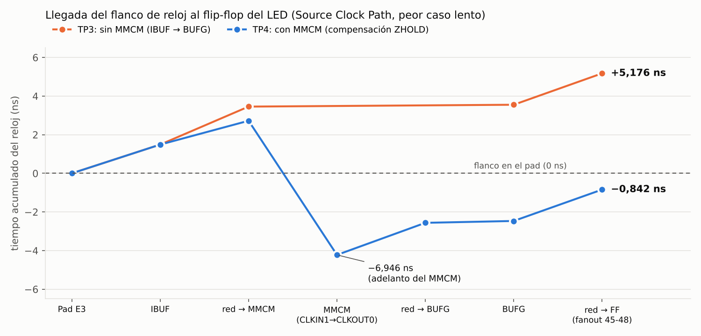
*Figura 15. Tiempo acumulado del reloj desde el pad E3 hasta el FF: sin MMCM llega a +5,176 ns; con MMCM, a −0,842 ns.*

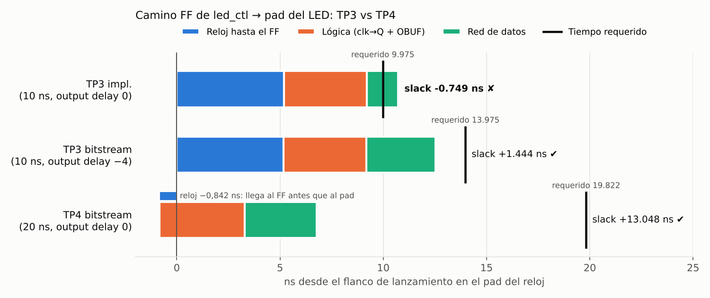
*Figura 16. Composición del camino del LED contra el tiempo requerido.*

| | TP3 (sin MMCM) | TP4 (con MMCM) |
|---|---|---|
| Reloj en el FF | +5,176 ns | **−0,842 ns** |
| Datos (clk→Q + red + OBUF) | 0,456 + 3,359 + 3,539 = 7,354 | 0,419 + 3,485 + 3,711 = 7,616 |
| Arrival | 12,531 ns | **6,774 ns** |
| Required | 13,975 (10 − 0,025 + 4) | 19,822 (20 − 0,178) |
| Slack | +1,444 (solo gracias al −4) | **+13,048** |

**Conclusiones del análisis:**

1. **La mejora no se debe solo al período más largo.** Con el reloj compensado, el mismo camino cumpliría incluso a 100 MHz y sin el truco del output delay: 10 − 0,178 − 6,774 = **+3,05 ns**. En el TP3 daba −0,749 ns. Lo que hacía fallar ese camino era el **retardo de inserción del reloj** (~5,2 ns), y el MMCM lo elimina.
2. **El hold de las entradas se cumple sin ayuda del router.** En el camino `rst_pin → meta_harden_rst/signal_meta_reg` (caso rápido), el reloj de captura llega en −0,792 ns y el dato en +0,987 ns, con una holgura de **+1,530 ns**.
   - En el TP3 sin compensación daba −1,544 ns en síntesis, y el router tuvo que alargar el ruteo del dato (2,656 ns) para corregirlo.
3. **Aumentó la incertidumbre del reloj**, de 0,025–0,035 ns a **0,178 ns**. Ahora incluye el jitter del MMCM (*discrete jitter* 0,152 ns) y su error de fase (0,099 ns). Es el precio de sintetizar la frecuencia con un PLL/MMCM.

### 5.4 Recursos y potencia

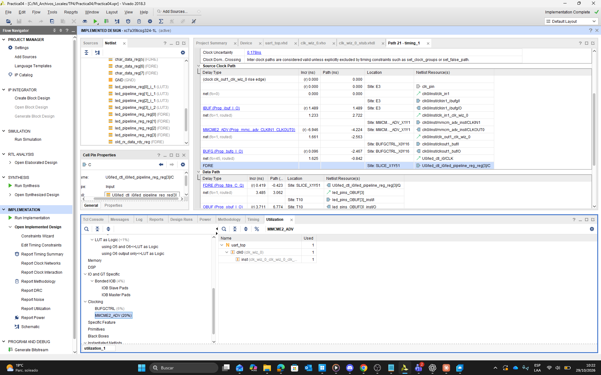
*Figura 17. Recursos de reloj: 1 MMCME2_ADV de 5 (20 %).*

| Recurso | TP3 | **TP4** | Disponible |
|---|---|---|---|
| Slice LUTs | 44 | **38** | 20 800 |
| Slice Registers | 48 | **45** | 41 600 |
| Slices | 19 | **13** | 8 150 |
| Bonded IOB | 9 | 9 | 210 |
| BUFGCTRL | 1 | **2** (`clk_out1` + realimentación) | 32 |
| MMCME2_ADV | 0 | **1** | 5 |
| **Potencia total** | 66 mW | **170 mW** | |
| — dinámica | 4 mW | **108 mW** (MMCM: 106 mW) | |
| — estática | 62 mW | 62 mW | |

- La lógica bajó un poco porque la estrategia es *Vivado Synthesis Defaults*: la FSM queda en codificación secuencial (`FSM_sequential_state_reg`) en vez de one-hot.
- **El MMCM es, por lejos, el mayor consumidor del diseño**: su VCO oscila a 1 GHz. Generar relojes con un MMCM tiene un costo de potencia que hay que justificar.

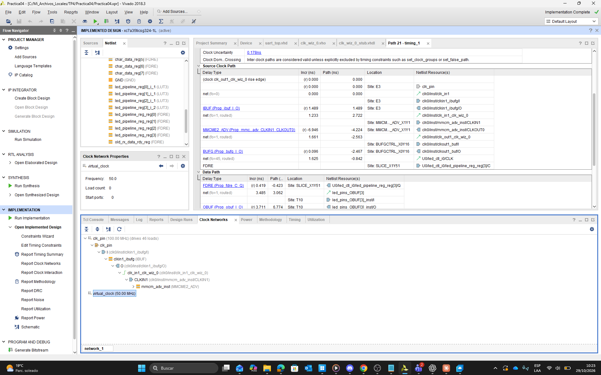
*Figura 18. Red de reloj: `clk_pin` → IBUF (`clkin1_ibufg`) → `CLKIN1` del **MMCME2_ADV** → BUFG → 46 cargas. `virtual_clock` (50 MHz) no tiene red física.*

### 5.5 Bitstream (3-1-5)

Se generó `Practica04.runs\impl_1\uart_top.bit` a partir de esta misma implementación, sin volver a correr place & route, así que los números de timing de esta sección son los del archivo que va a la placa.

---

## 6. Reset del MMCM y de la UART

En `uart_top.vhd` el mismo `rst_pin` (BTN0) se conecta a la entrada `reset` del MMCM y al reset de la UART:

- Mientras `rst_pin` está activo, el MMCM está en reset y **no entrega reloj**. El reset de la UART es sincrónico (pasa por `meta_harden`), por lo que **nunca llega a aplicarse**.
- Al soltar BTN0 el MMCM se vuelve a enganchar en pocos microsegundos y la UART continúa con el estado que tenía.
- Al configurar la FPGA todos los FF arrancan en 0 (`INIT = 0`), por lo que el diseño arranca correctamente aunque el reset no se aplique nunca.

**Consecuencia en la placa:** BTN0 **no borra** la UART. Mientras está apretado detiene el reloj y congela los LEDs; al soltarlo los LEDs conservan el valor anterior. En el TP3, en cambio, los LEDs se borraban al soltar el reset.

**Mejora propuesta (fuera del enunciado):** generar el reset interno a partir de `locked`, de modo que la UART quede en reset hasta que el MMCM esté estable y con el reloj funcionando:

```vhdl
	signal locked:  std_logic;
	signal rst_int: std_logic;
	...
	clk0: clk_wiz_0 port map(clk_out1 => clk50, reset => rst_pin, locked => locked, clk_in1 => clk_pin);
	rst_int <= rst_pin or not locked;
	U0: uart_led ... port map(clk_pin => clk50, rst_pin => rst_int, ...);
```

---

## 7. Conclusiones

1. El **IP Catalog** permite generar y parametrizar bloques complejos (aquí un MMCM) sin escribir HDL. El flujo es: configurar el IP, generarlo (síntesis *out-of-context*) e instanciarlo con la plantilla `.vho`.
2. El wizard eligió M = 10, D = 1 y O = 20 (VCO de 1 GHz) para obtener exactamente 50 MHz, y Vivado **derivó automáticamente** el reloj generado `clk_out1_clk_wiz_0`. No hubo que restringirlo a mano.
3. La **compensación ZHOLD** del MMCM cancela el retardo de inserción del reloj: el flanco llega a los FF 0,84 ns antes que al pad, contra 5,2 ns de atraso sin MMCM. Por eso el diseño cumple timing **sin relajar ninguna restricción** (WNS +13,048, WHS +0,054), y el hold de las entradas se cumple sin que el router tenga que corregirlo.
4. El costo es una mayor **incertidumbre del reloj** (0,178 ns por jitter y error de fase) y, sobre todo, **potencia**: el MMCM consume 106 mW, más que todo el resto del diseño.
5. Conectar el `reset` del MMCM al mismo botón que resetea la lógica es una mala práctica: la lógica nunca ve el reset con reloj. Lo correcto es derivar el reset interno de `locked`.

---

## 8. Paso 4 — Verificación en la placa

### 8.1 Conexión y programación (4-1)

La placa se conectó con un único cable micro-USB en **J10 (PROG/UART)**. Desde *Open Hardware Manager → Open Target → Auto Connect* se detectó **`xc7a35t_0`** y se programó con `Practica04.runs\impl_1\uart_top.bit`. El LED **DONE** se encendió al finalizar la configuración.

### 8.2 Terminal (4-2-1 a 4-2-3)

TeraTerm sobre el puerto COM de la placa, **115200 baud, 8 bits, sin paridad, 1 bit de stop, sin control de flujo**, con *local echo* desactivado.

### 8.3 Prueba funcional (4-2-4 y 4-2-5)

LEDs: `led_pins[3..0]` = **LD7 LD6 LD5 LD4** (● encendido, ○ apagado).

| Tecla | ASCII | BTN1 suelto (nibble bajo) | BTN1 apretado (nibble alto) | Eco | LEDs |
|---|---|---|---|---|---|
| `A` | 0x41 | ○○○● (0001) | ○●○○ (0100) | ✔ | ✔ |
| `a` | 0x61 | ○○○● (0001) | ○●●○ (0110) | ✔ | ✔ |
| `0` | 0x30 | ○○○○ (0000) | ○○●● (0011) | ✔ | ✔ |
| `5` | 0x35 | ○●○● (0101) | ○○●● (0011) | ✔ | ✔ |
| `U` | 0x55 | ○●○● (0101) | ○●○● (0101) | ✔ | ✔ |
| `z` | 0x7A | ●○●○ (1010) | ○●●● (0111) | ✔ | ✔ |
| `~` | 0x7E | ●●●○ (1110) | ○●●● (0111) | ✔ | ✔ |

Cada carácter apareció una sola vez en la terminal y los LEDs mostraron el nibble bajo, o el alto con BTN1 apretado. El comportamiento es idéntico al del TP3, con lo que queda verificado que **la UART recibe correctamente con el reloj de 50 MHz generado por el MMCM** y el divisor de baudios recalculado a 27.

### 8.4 Prueba del reset con el MMCM (BTN0)

| Acción | Resultado |
|---|---|
| Mantener apretado BTN0 con un carácter en los LEDs (`z` → ●○●○) | Los LEDs quedaron **congelados** con el último valor ✔ |
| Tipear un carácter con BTN0 apretado | El **eco apareció** en la terminal (camino combinacional, no depende del reloj); los **LEDs no cambiaron** ✔ |
| Soltar BTN0 | Los LEDs **conservaron el valor anterior**, a diferencia del TP3 ✔ |
| Tipear otro carácter | La UART siguió funcionando normalmente ✔ |

Los resultados coinciden con el análisis de la sección 6.

### 8.5 Cierre (4-2-6 a 4-2-8)

Se cerró el Hardware Manager (*File → Close Hardware Manager*) y la terminal, y luego se desconectó la placa.
