# TP5 — Asignación de Restricciones

**Sistemas Digitales (66.17 / 86.41) · Taller de Sistemas Digitales (TA147) — FIUBA**
**Alumno:** Aleksey Chahuillco · **Padrón:** 110929

| Herramienta | Placa / dispositivo | Proyecto |
|---|---|---|
| Vivado 2018.3 | Digilent **Arty A7-35** — `xc7a35ticsg324-1L` | `TP5\Practica05` (runs `synth_1` / `impl_1`) |

---

## 1. Objetivo

En las prácticas anteriores las restricciones (ubicación de pines y temporización) venían en archivos `.xdc` ya escritos. En esta práctica se **crean desde cero**:

- **Restricciones de ubicación**: con un *I/O Planning Project* se definen los puertos y se asignan a pines físicos, por la interfaz gráfica (vista *Package*) y por comandos Tcl.
- **El top-level**: se genera automáticamente con *Migrate to RTL*.
- **Restricciones de temporización**: se crean con el *Timing Constraints Wizard*.

El sistema es el mismo de las prácticas anteriores: la UART receptora que muestra un nibble del carácter recibido en 4 LEDs, más el eco `rxd → txd`.

---

## 2. Adaptación del enunciado (Arty Z7-10) a la Arty A7-35

| Puerto | Enunciado (Z7-10) | **Arty A7-35** | Recurso de la placa | Banco |
|---|---|---|---|---|
| `clk_pin` | H16 | **E3** | Oscilador 100 MHz | 35 |
| `btn_pin` | D19 | **C9** | BTN1 | 16 |
| `rst_pin` | L19 | **D9** | BTN0 | 16 |
| `rxd_pin` | Y18 (Pmod JA) | **A9** | `uart_txd_in` (USB-UART, PC → FPGA) | 16 |
| `txd_pin` | Y19 (Pmod JA) | **D10** | `uart_rxd_out` (USB-UART, FPGA → PC) | 16 |
| `led_pins[0..3]` | R14, P14, N16, M14 | **H5, J5, T9, T10** | LD4, LD5, LD6, LD7 | 35, 35, 14, 14 |

| Otros cambios | Enunciado | A7-35 |
|---|---|---|
| Reloj en el *Constraints Wizard* (3-1-5) | 125 MHz | **100 MHz** (10 ns) |
| `CLOCK_RATE` (2-4-2) | 125E6 | **100E6** |
| Bus `led_pins` (2-3-1) | *from 0 to 3* | **from 3 to 0** (ver sección 3.3) |

Se mantuvo la asignación de botones de los TPs anteriores (BTN0 = reset, BTN1 = nibble alto) para que la prueba en placa sea la misma en todos los TPs.

---

## 3. Paso 1 y 2 — Proyecto de planificación de I/O y asignación de pines

### 3.1 Proyecto *I/O Planning* (1-1)

Se creó `Practica05` como **I/O Planning Project**, con *Do not import I/O ports at this time*, sobre la parte `xc7a35ticsg324-1L`. Este tipo de proyecto no tiene fuentes HDL: solo el dispositivo y sus pines, para planificar la interfaz antes de escribir el diseño.

### 3.2 Puertos escalares y asignación desde la vista *Package* (2-1, 2-2)

Con **Create I/O Ports** se crearon `clk_pin`, `btn_pin`, `rst_pin` y `rxd_pin` como entradas y `txd_pin` como salida, todos **LVCMOS33**. Después se asignaron a sus pines desde la vista *Package* y la pestaña *Package Pins*.

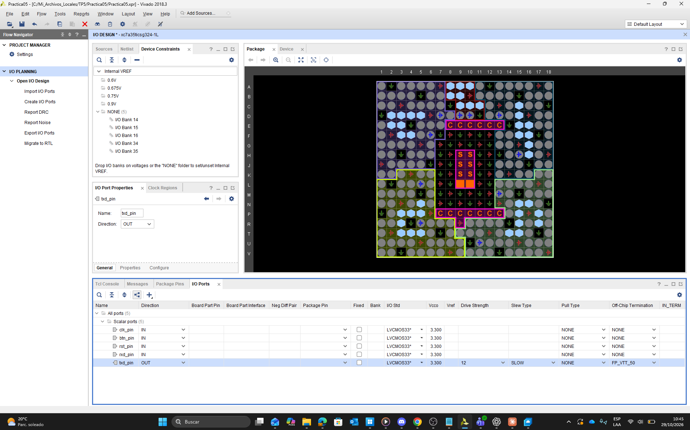
*Figura 1. I/O Planning: cinco puertos escalares creados, todavía sin pin asignado. A `txd_pin`, como salida, Vivado le asigna por defecto drive 12 mA y slew SLOW.*

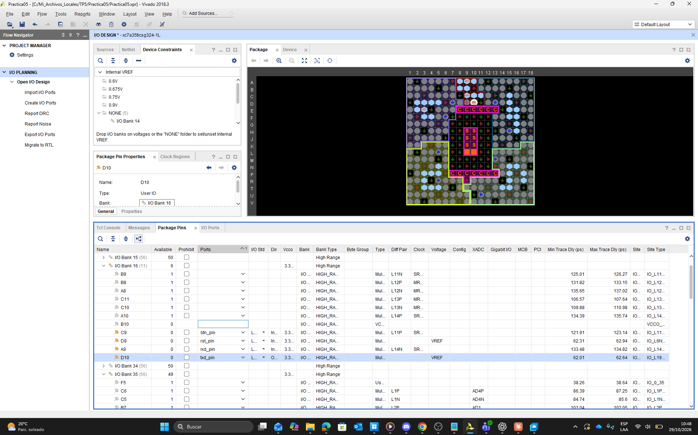
*Figura 2. Package Pins: `btn_pin` → C9, `rst_pin` → D9, `rxd_pin` → A9 y `txd_pin` → D10, todos en el **banco 16** (3,3 V). La columna *Available* pasa a 0 al ocupar el pin.*

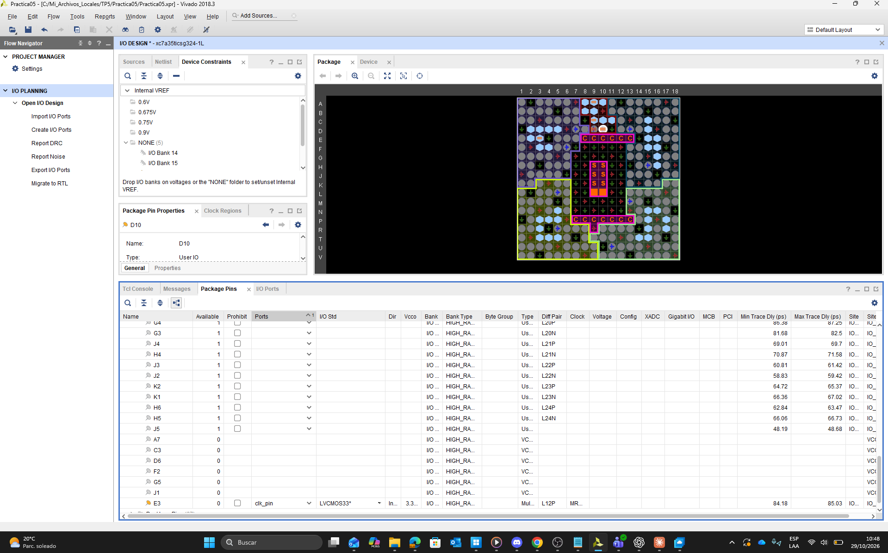
*Figura 3. `clk_pin` → **E3** (banco 35), un pin *MRCC* (*clock capable*), necesario para que el reloj entre al árbol global a través de un BUFG.*

### 3.3 Bus de LEDs y asignación por Tcl (2-3)

**Problema encontrado.** En el primer intento, el bus quedó creado con el rango **3 a 31**: 29 puertos (`led_pins[3]` … `led_pins[31]`), y la lista *All ports* mostraba 34 puertos. Por eso el comando Tcl sobre `led_pins[0]` falló:

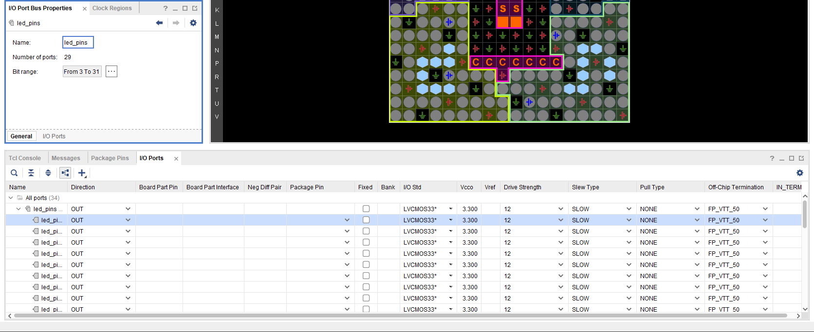
*Figura 4. I/O Port Bus Properties: `Number of ports: 29`, `Bit range: From 3 To 31`.*

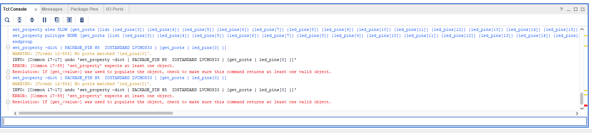
*Figura 5. `WARNING: [Vivado 12-584] No ports matched 'led_pins[0]'` y `ERROR: [Common 17-55] 'set_property' expects at least one object`.*

**Corrección.** Se borró el bus y se volvió a crear con el rango correcto. Después se ejecutaron los comandos de ubicación:

```tcl
remove_port [get_ports led_pins*]
create_port -direction OUT -from 3 -to 0 led_pins
set_property IOSTANDARD LVCMOS33 [get_ports {led_pins[*]}]

set_property -dict { PACKAGE_PIN H5  IOSTANDARD LVCMOS33 } [get_ports { led_pins[0] }]
set_property -dict { PACKAGE_PIN J5  IOSTANDARD LVCMOS33 } [get_ports { led_pins[1] }]
set_property -dict { PACKAGE_PIN T9  IOSTANDARD LVCMOS33 } [get_ports { led_pins[2] }]
set_property -dict { PACKAGE_PIN T10 IOSTANDARD LVCMOS33 } [get_ports { led_pins[3] }]
```

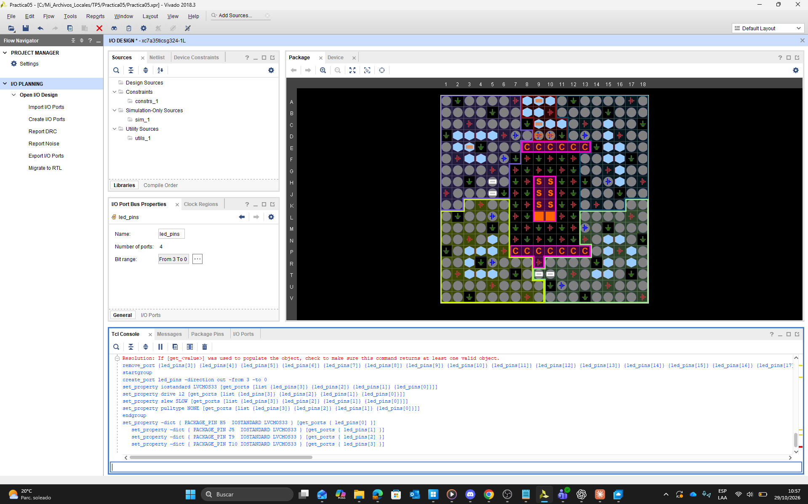
*Figura 6. Bus corregido (4 puertos, *From 3 To 0*) y comandos Tcl ejecutados sin errores. En la vista *Package* se ven los pines ocupados en H5/J5 (izquierda) y T9/T10 (abajo).*

**¿Por qué "from 3 to 0" y no "from 0 to 3" como dice el enunciado?** El orden del rango define el tipo VHDL que genera *Migrate to RTL*:
- Con "0 to 3", el puerto queda `std_logic_vector(0 to 3)`.
- Al conectarlo con el `std_logic_vector(3 downto 0)` de `uart_led`, VHDL asocia los elementos **por posición, no por índice**: `led_pins(0)` del top quedaría conectado al bit 3 de la UART, y los LEDs saldrían **en orden invertido**.
- Con "from 3 to 0" los dos quedan `(3 downto 0)` y coinciden.

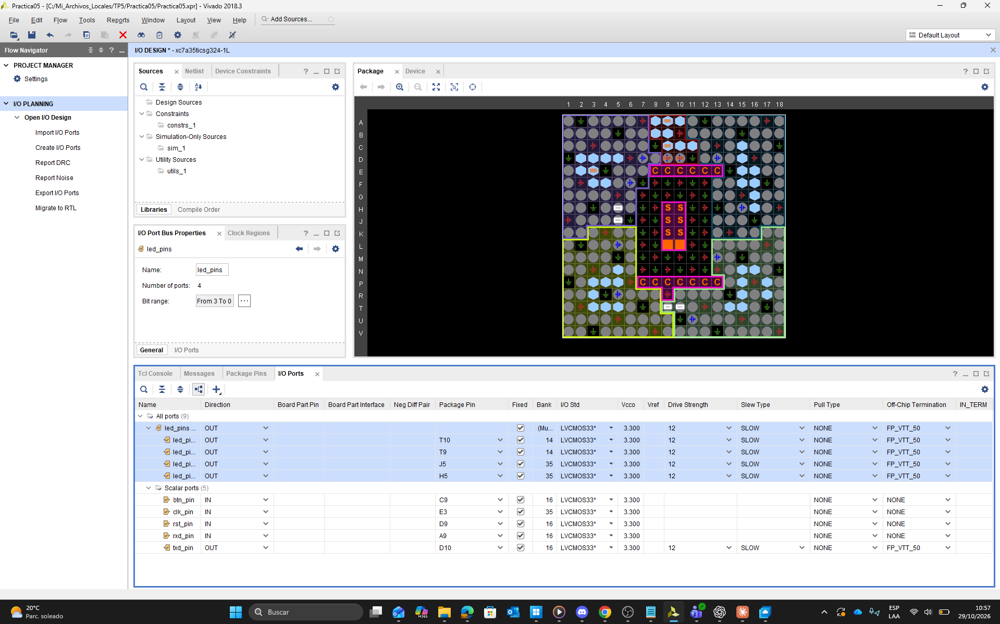
*Figura 7. Los 9 puertos con pin asignado, LVCMOS33 y **Fixed** tildado.*

Las restricciones se guardaron con **File → Constraints → Save** como `uart_led_pins_ArtyA7.xdc` (Anexo A).

### 3.4 *Migrate to RTL* (2-3-3, 2-3-4)

Con **Migrate to RTL** (formato VHDL, archivo `uart_top.vhd`), Vivado convierte el proyecto de planificación en un proyecto RTL y genera la **entidad `ios`** con los puertos definidos y una arquitectura vacía:

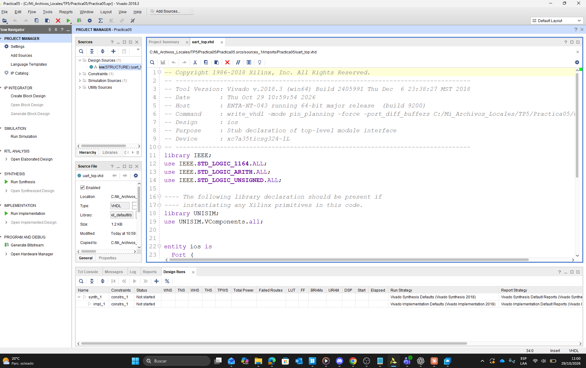
*Figura 8. El archivo fue generado con `write_vhdl -mode pin_planning`: es un "*stub declaration of top-level module interface*".*

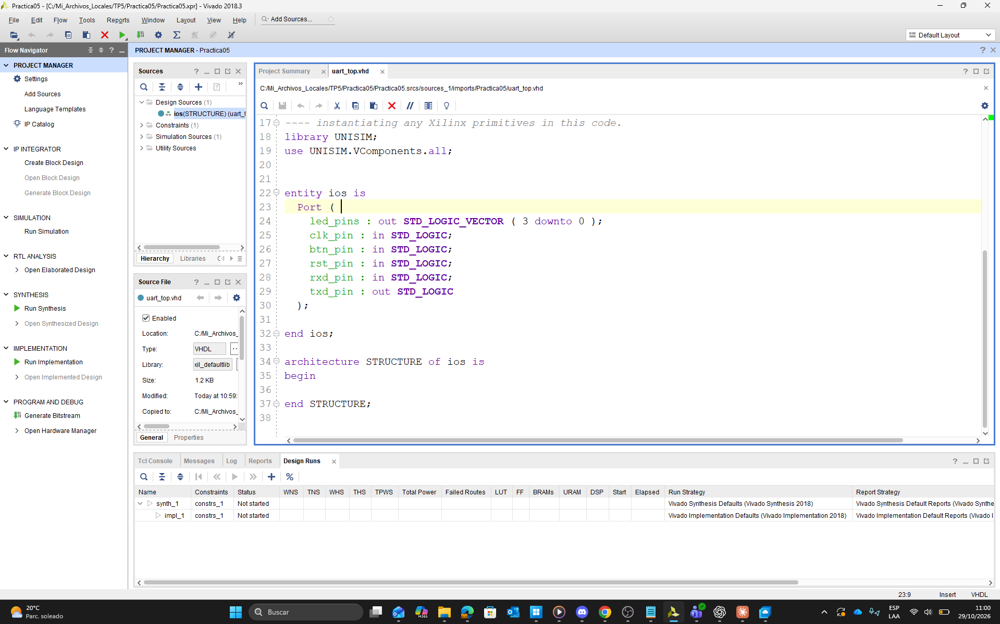
*Figura 9. Entidad `ios`: `led_pins : out STD_LOGIC_VECTOR (3 downto 0)` y los demás puertos escalares, con la arquitectura `STRUCTURE` vacía.*

### 3.5 Fuentes HDL y top-level (2-4)

Se agregaron los seis `.vhd` de la UART (`led_ctl`, `meta_harden`, `uart_baud_gen`, `uart_led`, `uart_rx`, `uart_rx_ctl`). `led_ctl.vhd` ya traía el intercambio de nibbles de los TPs anteriores (2-4-4). En la arquitectura de `ios` se agregaron el componente, el eco y la instancia:

```vhdl
architecture STRUCTURE of ios is

	component uart_led is
		generic(
			BAUD_RATE:  integer := 115200;
			CLOCK_RATE: integer := 100E6
		);
		port(
			clk_pin:  in  std_logic;
			rst_pin:  in  std_logic;
			btn_pin:  in  std_logic;
			rxd_pin:  in  std_logic;
			led_pins: out std_logic_vector(3 downto 0)
		);
	end component;

	signal loopback: std_logic;

begin

	loopback <= not rxd_pin;
	txd_pin  <= not loopback;

	U0: uart_led
		generic map(
			BAUD_RATE  => 115200,
			CLOCK_RATE => 100E6
		)
		port map(
			clk_pin  => clk_pin,
			rst_pin  => rst_pin,
			btn_pin  => btn_pin,
			rxd_pin  => rxd_pin,
			led_pins => led_pins
		);

end STRUCTURE;
```

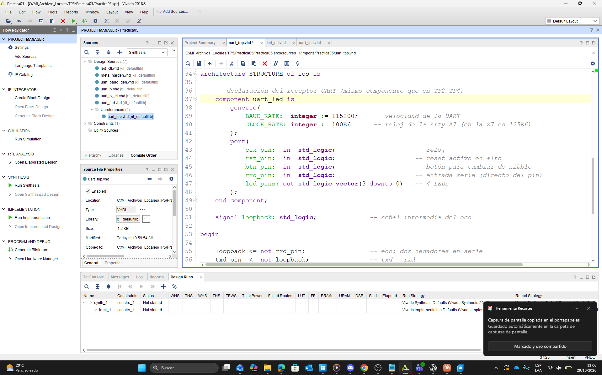
*Figura 10. Componente `uart_led` y señal `loopback` en la arquitectura de `ios`.*

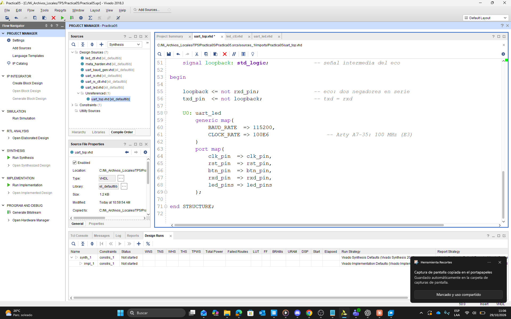
*Figura 11. Eco e instancia `U0` con `CLOCK_RATE => 100E6`.*

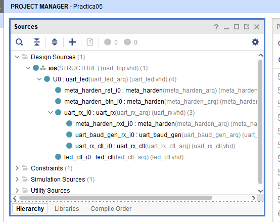
*Figura 12. Jerarquía final: `ios → U0 : uart_led → meta_harden (×2), uart_rx (meta_harden, uart_baud_gen, uart_rx_ctl), led_ctl`.*

---

## 4. Paso 3 — Síntesis y restricciones de temporización

### 4.1 *Timing Constraints Wizard* (3-1)

Para no mezclar las restricciones de ubicación con las de temporización, antes de abrir el wizard se creó un segundo archivo, `uart_led_timing_ArtyA7.xdc`, y se lo marcó como **Target Constraint File**. Con el diseño sintetizado abierto, se recorrió el asistente:

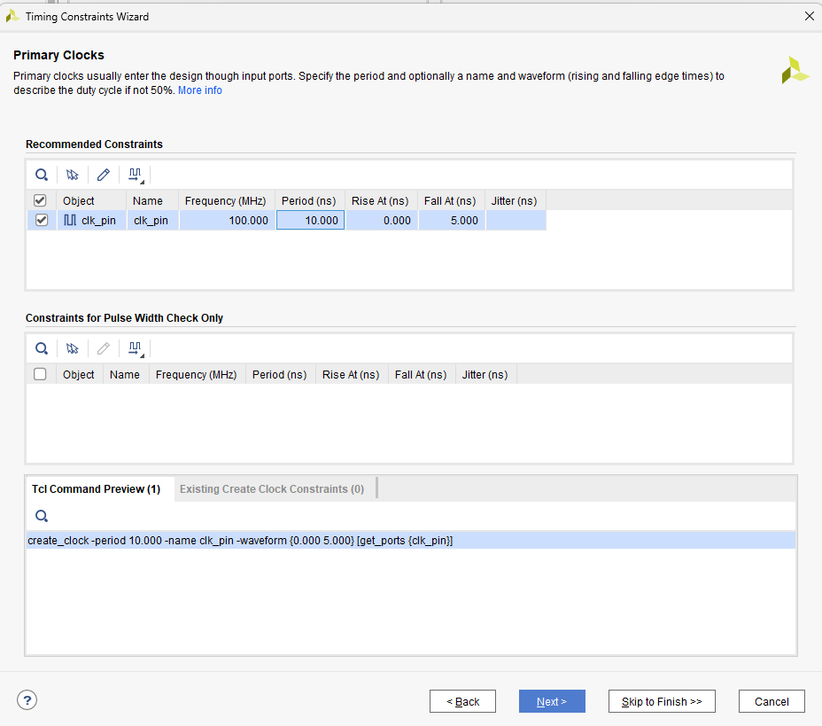
*Figura 13. **Primary Clocks**: el wizard detecta `clk_pin` como reloj. Se fija en **100 MHz** (período 10 ns, flanco ascendente en 0 y descendente en 5 ns), y en la vista previa aparece el comando `create_clock -period 10.000 -name clk_pin -waveform {0.000 5.000} [get_ports {clk_pin}]`.*

| Pantalla | Decisión | Justificación |
|---|---|---|
| Generated / Forwarded Clocks / External Feedback | Nada | No hay relojes derivados, ni relojes que salgan de la FPGA, ni realimentación externa |
| **Input Delays** | Se destildan `btn_pin`, `rst_pin` y `rxd_pin` | Son señales **asincrónicas** (botones y la UART) que no se generan con ningún reloj conocido; se sincronizan dentro de la FPGA con `meta_harden` |
| **Output Delays** | Se destilda `led_pins[*]` | El destino son LEDs, que no tienen requisitos de setup/hold |
| **Combinational Delays** | Se destilda `rxd_pin → txd_pin` | Es un camino pad → pad sin requisitos (el eco) |
| Clock groups (4 pantallas) | Nada | Hay un único reloj |

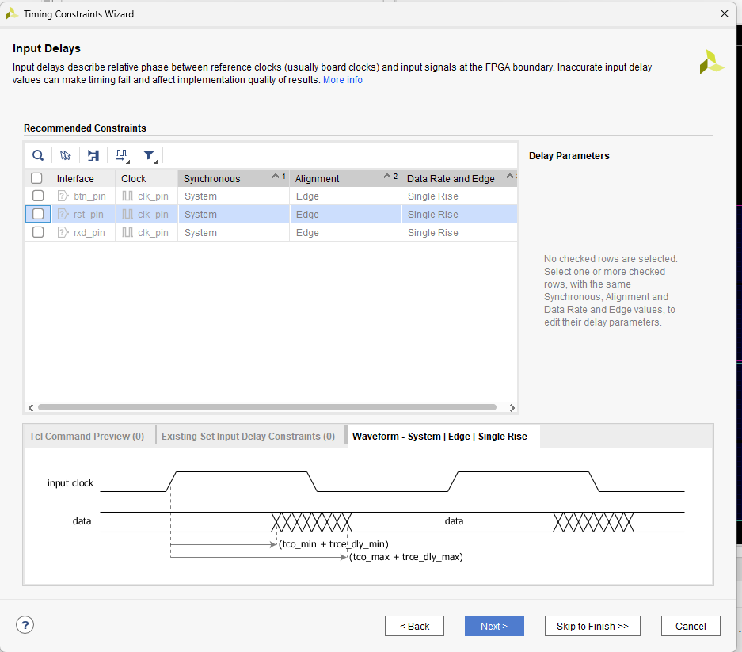
*Figura 14. Input Delays sin tildar. La forma de onda muestra lo que se habría restringido: el dato válido entre `tco_min + trce_dly_min` y `tco_max + trce_dly_max` después del flanco del reloj externo.*

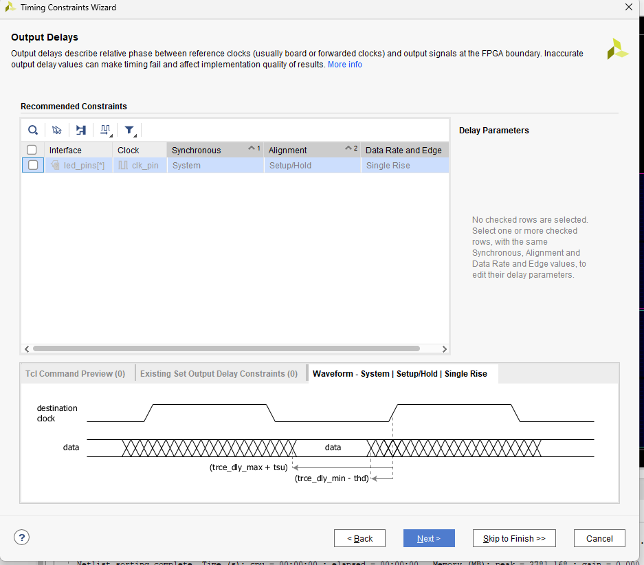
*Figura 15. Output Delays sin tildar. El requisito sería `trce_dly_max + tsu` antes del flanco (setup) y `trce_dly_min − thd` (hold) del dispositivo receptor.*

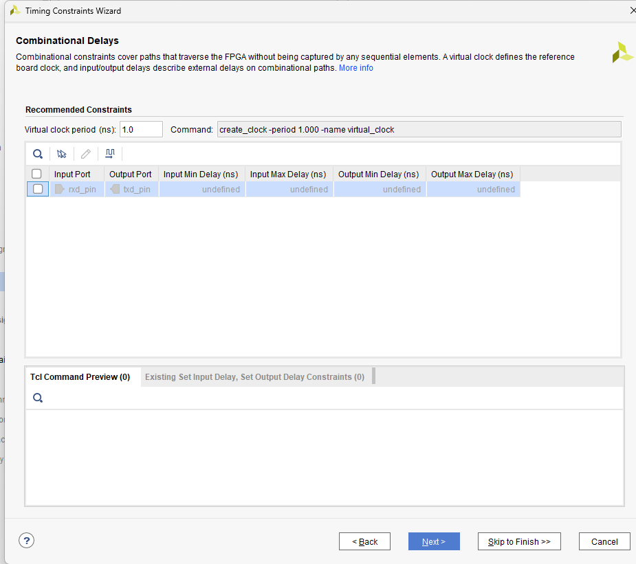
*Figura 16. Combinational Delays: el wizard propone un **reloj virtual** como referencia para los retardos de entrada y salida del camino puramente combinacional `rxd_pin → txd_pin`. No se crea.*


*Figura 17. El wizard creó **una única restricción**: `Create Clock (1)`.*

**`uart_led_timing_ArtyA7.xdc` resultante:**
```tcl
create_clock -period 10.000 -name clk_pin -waveform {0.000 5.000} [get_ports clk_pin]
```

### 4.2 Timing estimado post-síntesis (3-2)

Al agregar la restricción, la síntesis quedó desactualizada; se volvió a sintetizar y se generó el *Timing Summary*.

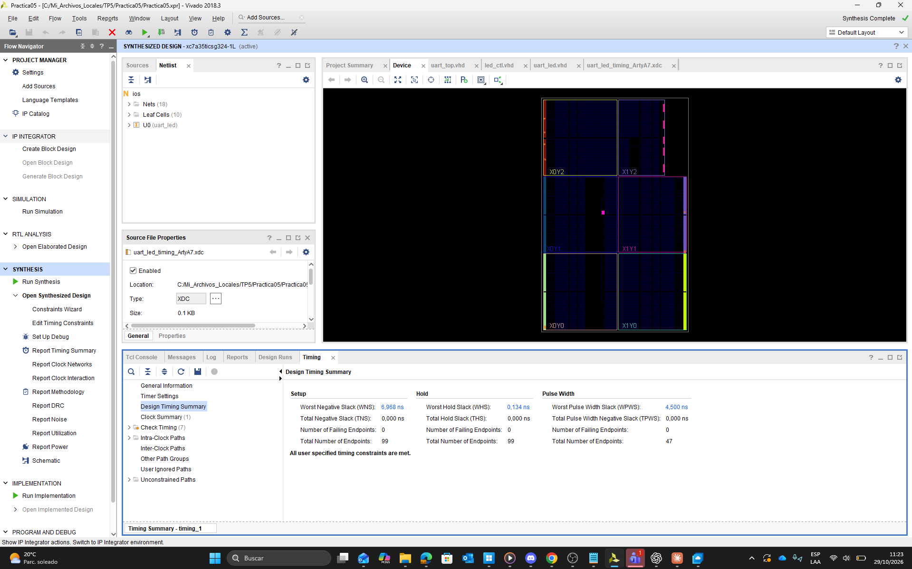
*Figura 18. Post-síntesis: WNS **+6,968 ns**, WHS **+0,134 ns**, WPWS +4,500 ns, 99 endpoints, *All user specified timing constraints are met*.*

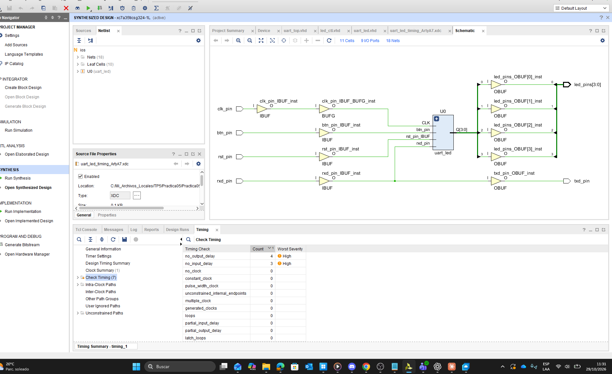
*Figura 19. Esquemático sintetizado (IBUF/BUFG/OBUF y el eco `rxd → txd` reducido a IBUF → OBUF) y **Check Timing**: `no_input_delay` = 3 y `no_output_delay` = 4.*

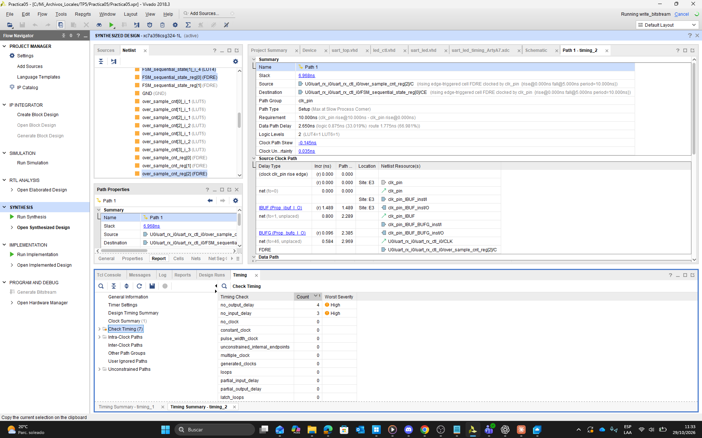
*Figura 20. Peor camino post-síntesis: `over_sample_cnt_reg[2]/C → FSM_sequential_state_reg[0]/CE` en `uart_rx_ctl`, con 2 niveles lógicos (LUT4 + LUT6) y 2,650 ns de datos (33 % lógica, 67 % red). Las redes figuran como *unplaced*: son estimaciones.*

**Lectura del Check Timing:**
- `no_input_delay = 3`: `rst_pin`, `btn_pin` y `rxd_pin`.
- `no_output_delay = 4`: los cuatro `led_pins`. **`txd_pin` no aparece** porque su camino viene de `rxd_pin` y es puramente combinacional: no sale de ningún flip-flop, así que no tiene reloj de referencia. Figura en *Unconstrained Paths*. Es exactamente el caso para el que existe el reloj virtual de la Figura 16.

---

## 5. Paso 4 — Implementación y análisis temporal

Se implementó el diseño y se generó el bitstream `Practica05.runs\impl_1\ios.bit`. Valores tomados de `ios_timing_summary_routed.rpt`:

| | Post-síntesis (estimado) | **Post-implementación** |
|---|---|---|
| WNS | +6,968 ns | **+6,638 ns** |
| WHS | +0,134 ns | **+0,174 ns** |
| WPWS | +4,500 ns | +4,500 ns |
| Endpoints | 99 | 99 |
| Fallas | 0 | **0** — *All user specified timing constraints are met* |

**Peor camino post-ruteo** (`uart_rx_ctl`):

```
Source:      over_sample_cnt_reg[0]/C   ->   Destination: state_reg[0]/CE   (clk_pin, 10 ns)
  E3  IBUF                         1.489   1.489
      net                          1.967   3.455
      BUFG                         0.096   3.551
      net (fo=46)                  1.621   5.172   <- reloj en el FF origen
      FDRE clk->Q                  0.456   5.628
      net (fo=8)                   0.877   6.505
      LUT4  (over_sample_cnt_done) 0.149   6.654
      net (fo=17)                  0.881   7.535
      LUT6                         0.332   7.867
      net (fo=4)                   0.391   8.258   <- arrival
  reloj en el FF destino: 10 + 4.877 = 14.877; + pessimism 0.259 - uncertainty 0.035
  - setup CE 0.205  =  required 14.896
  slack = 14.896 - 8.258 = 6.638 ns
```

Lectura del camino:
- **El reloj llega con ≈ 5,2 ns de retardo de inserción, igual que en el TP3** (IBUF → BUFG → árbol), porque no hay MMCM que lo compense. Como origen y destino lo reciben casi igual (skew −0,036 ns), en un camino interno ese retardo se cancela.
- El camino de datos mide 3,086 ns (30 % lógica, **70 % ruteo**), así que la lógica interna podría funcionar a ≈ 1 / (10 − 6,638) ns ≈ **297 MHz**.

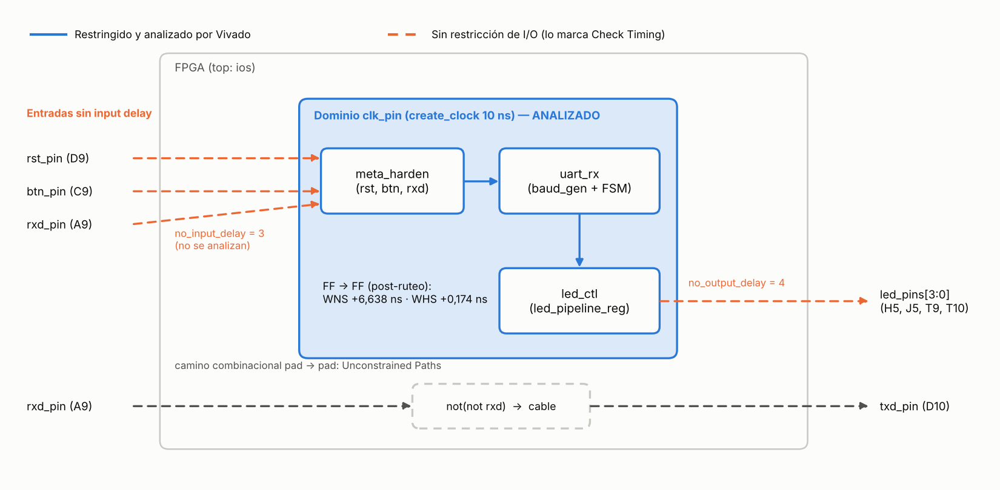
*Figura 21. Cobertura de las restricciones del TP5: solo se analizan los caminos internos del dominio `clk_pin`. Las entradas, los LEDs y el eco quedan fuera del análisis.*

### 5.1 Recursos, potencia y advertencias

| Recurso | Usado | Disponible |
|---|---|---|
| Slice LUTs | 40 | 20 800 |
| Slice Registers | 46 | 41 600 |
| Slices | 18 | 8 150 |
| Bonded IOB | 9 | 210 |
| BUFGCTRL | 1 | 32 |
| **Potencia** | **65 mW** (62 estática + 3 dinámica) | |

| Advertencia | Causa |
|---|---|
| Methodology `TIMING-18` ×7 | 3 entradas sin input delay + 4 salidas sin output delay: es la consecuencia de lo decidido en el wizard |
| DRC `CFGBVS-1` | El XDC generado por el *I/O Planning Project* no incluye `CFGBVS` / `CONFIG_VOLTAGE`, que en los TPs anteriores venían en el XDC de pines. No afecta el funcionamiento; se corrige agregando `set_property CFGBVS VCCO [current_design]` y `set_property CONFIG_VOLTAGE 3.3 [current_design]` |

---

## 6. Comparación de las restricciones de temporización TP3 / TP4 / TP5

| | TP3 | TP4 | **TP5** |
|---|---|---|---|
| Origen del XDC | Provisto por la cátedra | Provisto por la cátedra | **Creado con el wizard** |
| Reloj | `clk_pin` 10 ns | `clk_pin` 10 ns → MMCM → 20 ns | `clk_pin` 10 ns |
| Reloj virtual | Sí (12 → 10 ns) | Sí (20 ns) | **No** |
| Input / output delays | Sí (output −4 ns) | Sí | **No** |
| Caminos de I/O analizados | Sí | Sí | **No** (Check Timing: 7) |
| WNS / WHS final | +1,444 / +0,134 | +13,048 / +0,054 | **+6,638 / +0,174** |

El "todo cumple" del TP5 **no es comparable** con el de los TPs anteriores: en el TP5 solo se verifica la lógica interna. En el TP3, el camino que limitaba eran justamente las salidas a los LEDs (OBUF ≈ 3,5 ns más 5,2 ns de retardo del reloj), y acá ese camino no se analiza.

Dejar las I/O sin restricción es razonable en este sistema:
- **Entradas:** son asincrónicas y se sincronizan con `meta_harden`. Ningún input delay describiría bien a un botón o a una UART.
- **Salidas:** los LEDs no tienen requisitos de timing.

La forma más prolija de expresarlo, en lugar de dejarlas "sin restricción", es declararlas como *false paths*, para que **Check Timing quede limpio** y quede documentado que fue una decisión de diseño:

```tcl
set_false_path -from [get_ports {rst_pin btn_pin rxd_pin}]
set_false_path -to   [get_ports {led_pins[*] txd_pin}]
```

---

## 7. Conclusiones

1. El **I/O Planning Project** permite definir la interfaz física del diseño (puertos, estándares de I/O, bancos y pines) **antes** de tener el HDL, y generar a partir de ella el top-level con *Migrate to RTL*. La asignación se puede hacer gráficamente (vista *Package* / *Package Pins*) o por Tcl (`create_port`, `set_property PACKAGE_PIN`), y el resultado es el mismo XDC.
2. Hay que cuidar el **orden del rango de los buses**. El error del bus 3–31 se detectó gracias al mensaje del `set_property`. Un rango "0 to 3" no habría dado error, pero habría invertido los LEDs sin aviso.
3. El **Timing Constraints Wizard** recorre de forma sistemática todas las categorías de restricciones (relojes primarios, generados, *forwarded*, delays de I/O, caminos combinacionales y grupos de relojes) y escribe los comandos Tcl en el XDC de destino. Para este sistema la única restricción necesaria fue el **reloj primario de 100 MHz**.
4. El diseño cumple timing con amplio margen (WNS +6,638 ns post-ruteo), pero el **Check Timing** muestra 7 puertos sin restricción. Es importante distinguir "cumple" de "no se analizó". La práctica recomendada es declarar explícitamente esos caminos con `set_false_path`.

---

## 8. Verificación en la placa

La placa se conectó con un único cable micro-USB en **J10**. Desde *Open Hardware Manager → Open Target → Auto Connect* se detectó **`xc7a35t_0`** y se programó con `Practica05.runs\impl_1\ios.bit` (el nombre del bitstream sale del top `ios`). El LED **DONE** se encendió al finalizar la configuración. En TeraTerm se usó el puerto COM de la placa a **115200 baud, 8 bits, sin paridad, 1 bit de stop, sin control de flujo**, con *local echo* desactivado.

LEDs: `led_pins[3..0]` = **LD7 LD6 LD5 LD4** (● encendido, ○ apagado).

| Tecla | ASCII | BTN1 suelto (nibble bajo) | BTN1 apretado (nibble alto) | Eco | LEDs |
|---|---|---|---|---|---|
| `A` | 0x41 | ○○○● | ○●○○ | ✔ | ✔ |
| `0` | 0x30 | ○○○○ | ○○●● | ✔ | ✔ |
| `5` | 0x35 | ○●○● | ○○●● | ✔ | ✔ |
| `U` | 0x55 | ○●○● | ○●○● | ✔ | ✔ |
| `z` | 0x7A | ●○●○ | ○●●● | ✔ | ✔ |
| `~` | 0x7E | ●●●○ | ○●●● | ✔ | ✔ |

**Verificación de los pines asignados en el I/O Planning Project:**

| Puerto | Pin | Verificación | |
|---|---|---|---|
| `led_pins[0]` | H5 | Con `A` (○○○●) se enciende **LD4**: el bus no quedó invertido | ✔ |
| `led_pins[3..0]` | T10, T9, J5, H5 | Con `z` (●○●○) se encienden **LD7 y LD5** | ✔ |
| `rxd_pin` / `txd_pin` | A9 / D10 | Eco correcto en la terminal | ✔ |
| `btn_pin` | C9 | BTN1 cambia al nibble alto | ✔ |
| `rst_pin` | D9 | Con BTN0 apretado los LEDs mantienen el valor y se apagan al soltarlo, igual que en el TP3 | ✔ |
| `clk_pin` | E3 | La UART recibe correctamente a 115200 baud con `CLOCK_RATE => 100E6` | ✔ |

Al finalizar se cerró el Hardware Manager y la terminal antes de desconectar la placa.

---

## Anexo A — Restricciones finales

**`uart_led_pins_ArtyA7.xdc`**, generado por el *I/O Planning Project*:

```tcl
set_property IOSTANDARD LVCMOS33 [get_ports clk_pin]
set_property IOSTANDARD LVCMOS33 [get_ports btn_pin]
set_property IOSTANDARD LVCMOS33 [get_ports rst_pin]
set_property IOSTANDARD LVCMOS33 [get_ports rxd_pin]
set_property IOSTANDARD LVCMOS33 [get_ports txd_pin]
set_property DRIVE 12 [get_ports txd_pin]
set_property SLEW SLOW [get_ports txd_pin]
set_property PACKAGE_PIN E3 [get_ports clk_pin]
set_property PACKAGE_PIN C9 [get_ports btn_pin]
set_property PACKAGE_PIN D9 [get_ports rst_pin]
set_property PACKAGE_PIN A9 [get_ports rxd_pin]
set_property PACKAGE_PIN D10 [get_ports txd_pin]
set_property DRIVE 12 [get_ports {led_pins[3]}]
set_property DRIVE 12 [get_ports {led_pins[2]}]
set_property DRIVE 12 [get_ports {led_pins[1]}]
set_property DRIVE 12 [get_ports {led_pins[0]}]
set_property SLEW SLOW [get_ports {led_pins[3]}]
set_property SLEW SLOW [get_ports {led_pins[2]}]
set_property SLEW SLOW [get_ports {led_pins[1]}]
set_property SLEW SLOW [get_ports {led_pins[0]}]
set_property -dict {PACKAGE_PIN H5 IOSTANDARD LVCMOS33} [get_ports {led_pins[0]}]
set_property -dict {PACKAGE_PIN J5 IOSTANDARD LVCMOS33} [get_ports {led_pins[1]}]
set_property -dict {PACKAGE_PIN T9 IOSTANDARD LVCMOS33} [get_ports {led_pins[2]}]
set_property -dict {PACKAGE_PIN T10 IOSTANDARD LVCMOS33} [get_ports {led_pins[3]}]
```

**`uart_led_timing_ArtyA7.xdc`**, generado por el *Timing Constraints Wizard*:

```tcl
create_clock -period 10.000 -name clk_pin -waveform {0.000 5.000} [get_ports clk_pin]
```
